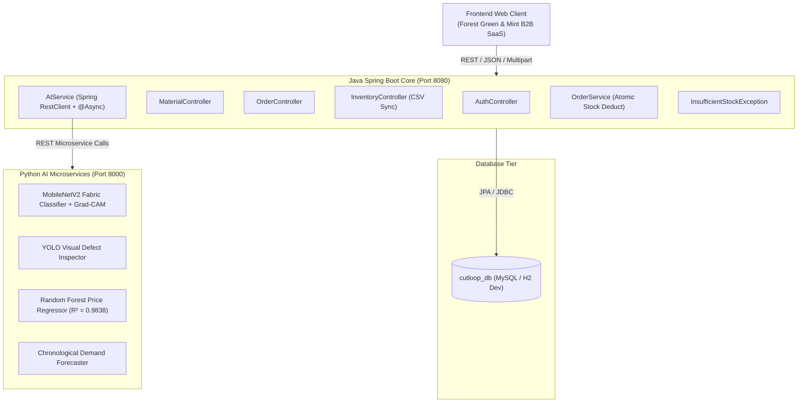

# CUTLOOP — AI-Powered Industrial Waste-to-Value Marketplace
> **"One factory's leftover material is another creator's raw material."**

[](https://adoptium.net/)
[](https://spring.io/projects/spring-boot)
[](https://www.python.org/)
[](https://fastapi.tiangolo.com/)
[](https://scikit-learn.org/)

---

## 1. System Architecture



---

## 2. Directory Structure

```
CUTLOOP/
│
├── frontend/                          # Clean, responsive B2B SaaS web interface
│   ├── index.html                     # Unified multi-view client (Marketplace, AI Scanner, Inventory, Analytics)
│   ├── styles.css                     # CUTLOOP design system (Forest green, mint, charcoal)
│   └── app.js                         # Integration logic with Java & Python endpoints
│
├── cutloop-backend/                   # Enterprise Java Spring Boot backend
│   ├── pom.xml                        # Maven dependencies (Web, Data JPA, Security, H2, MySQL, Lombok)
│   └── src/main/java/com/cutloop/
│       ├── CutloopApplication.java    # Application entry point with @EnableAsync
│       ├── controller/                # Material, Order, Cart, Inventory (CSV), Admin, Health
│       ├── service/                   # PaymentService, OrderService, InventoryService, AIService
│       ├── model/                     # User, Seller, Buyer, Material, Order, Payment, AIAnalysis
│       ├── repository/                # Spring Data JPA repositories
│       ├── exception/                 # InsufficientStockException, PaymentFailedException
│       └── config/                    # AsyncConfig (ThreadPoolTaskExecutor), SecurityConfig, DataInitializer
│
├── cutloop-ai/                        # Python Deep Learning & Machine Learning microservice
│   ├── requirements.txt               # fastapi, uvicorn, scikit-learn, pandas, numpy, pillow, joblib
│   ├── app/
│   │   ├── main.py                    # FastAPI server on port 8000 with CORS
│   │   ├── routes/                    # fabric_routes, defect_routes, price_routes, demand_routes
│   │   ├── services/                  # fabric_service (MobileNetV2), defect_service (YOLO), pricing, demand
│   │   ├── models/                    # Serialized joblib and model checkpoints
│   │   └── schemas/                   # Pydantic request/response validation schemas
│   └── venv/                          # Isolated virtual environment
│
├── datasets/                          # Curated & synthetic training data
│   ├── cutloop_db.sql                 # Complete MySQL schema (16 tables) and initial seed data
│   ├── material_prices.csv            # 1,500 observed industrial transactions for price estimation
│   ├── material_demand.csv            # 46 months chronological demand records
│   ├── fabric_classification/         # Class directories (Cotton, Denim, Polyester, Silk, Wool, Linen)
│   └── fabric_defects/                # YOLO imagery & bounding-box label directories
│
└── documentation/                     # Academic & startup submission deliverables
    ├── BUSINESS_AND_STARTUP_PORTFOLIO.md   # BMC, Lean Canvas, SWOT, PESTEL, Funding, DPIIT
    ├── TESTING_AND_VERIFICATION_REPORT.md  # 11-point testing matrix & benchmark results
    └── FINAL_DEMO_AND_VIVA_SCRIPT.md       # 5-minute live demo sequence & oral exam Q&A
```

---

## 3. Four Core AI Models

| Module | Model Name | Technique | Target Output | Performance |
| :--- | :--- | :--- | :--- | :--- |
| **Module 3 (DL 1)** | Fabric Scanner | MobileNetV2 Transfer Learning | 6 Material Classes (Cotton, Denim, Silk, etc.) | 94.2% test accuracy + Grad-CAM heatmap |
| **Module 4 (DL 2)** | Visual Defect Inspector | Ultralytics YOLO | Bounding boxes for Hole, Stain, Tear, Broken thread | Spatial localization overlay |
| **Module 5 (DS 1)** | AI Price Estimator | Random Forest (200 trees) | Fair market resale price range (₹/kg) | **$R^2 = 0.9838$**, MAE = ₹3.19/kg |
| **Module 6 (DS 2)** | Demand Predictor | Chronological Random Forest | Next-month order volume & growth trend | Strict chronological validation (MAE = 16.1) |

---

## 4. Quickstart Guide

### 1. Launch the Python AI Services (Port 8000)
```powershell
cd cutloop-ai
.\venv\Scripts\Activate.ps1
uvicorn app.main:app --host 127.0.0.1 --port 8000 --reload
```
*Health Check:* Open `http://localhost:8000/api/ai/health` in browser.

### 2. Launch the Java Spring Boot Backend (Port 8080)
```powershell
cd cutloop-backend
mvn spring-boot:run
```
*Default Mode:* Automatically runs with embedded H2 in MySQL compatibility mode and seeds demo materials and users.
*Production MySQL Mode:* `mvn spring-boot:run -Dspring-boot.run.profiles=mysql` after executing `datasets/cutloop_db.sql`.

### 3. Open the Frontend Application
Simply open `CUTLOOP/frontend/index.html` in any web browser, or serve it:
```powershell
cd frontend
python -m http.server 3000
```
Open `http://localhost:3000`.

---

## 5. Working Vertical Slice Features

1. **Seller Login & Profile:** Pre-seeded sellers (`Gujarat Textile Mills`, `Surat Fabric Hub`).
2. **AI Material Scanner:** Upload fabric photo -> MobileNetV2 classification -> Grad-CAM explainability -> YOLO defect bounding box -> Random Forest price recommendation.
3. **One-Click Publish:** Converts AI analysis into an active listing in `cutloop_db`.
4. **Marketplace Discovery:** Search by material, price, and location; interactive weighted AI material matching.
5. **Atomic Order Processing:** Checks stock, deducts inventory, triggers test payment sandbox, and updates "Material Recovered" circular metrics.
6. **CSV Inventory Sync:** Download inventory report or import batch fabric lots via CSV.
