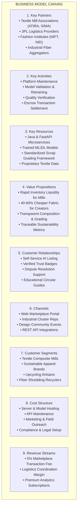

# CUTLOOP — Business Model Canvas (Osterwalder Framework)

**Venture:** CUTLOOP — AI-Powered Circular Textile Waste Platform  
**Document Reference:** `submission/01_startup/BUSINESS_MODEL_CANVAS.md`  

---

---

## The 9 Business Model Canvas Building Blocks

### 1. Key Partners
* **Industrial Textile Associations:** Partnerships with regional bodies such as the Ahmedabad Textile Industry's Research Association (ATIRA) and Southern India Mills' Association (SIMA) for supplier onboarding.
* **Logistics & Freight Partners:** Regional third-party logistics providers (Shiprocket, Delhivery, V-Trans) specializing in B2B pallet and roll freight.
* **Academic & Design Hubs:** Collaborations with fashion institutes (NIFT, NID) to supply capstone design students with sustainable fabric.
* **Circular Fiber Aggregators:** Partnerships with mechanical shredders and shoddy yarn producers to clear high-volume Grade D non-apparel waste.

### 2. Key Activities
* **Platform Development:** Continuous maintenance of the Java Spring Boot core and Python FastAPI inference services.
* **Data Science & ML Engineering:** Monitoring model drift, updating virgin spot price benchmarks, and refining visual classification heads.
* **Trust & Quality Moderation:** Reviewing seller listings to ensure adherence to standardized grading criteria.
* **Escrow Settlement:** Securely releasing buyer funds to sellers upon physical receipt and verification of scrap fabric lots.

### 3. Key Resources
* **Intellectual & Technical Assets:** Custom software architecture, trained weights for Model B (MobileNetV2), Model A (Random Forest), and Model C (K-Means).
* **Proprietary Datasets:** Curated 47,522 garment composition records and 2,252 benchmark vision images.
* **Domain Knowledge:** Standardized four-tier textile scrap classification methodology (Deadstock, Remnants, Scraps, Shred).

### 4. Value Propositions
* **For Mills & Exporters (Sellers):**
  * Immediate digital inventory visibility for leftover cutting scraps and deadstock rolls.
  * Reduction in warehouse holding expenses and avoidance of disposal penalties.
  * Creation of a secondary revenue stream from unutilized pre-consumer assets.
* **For Designers & Studios (Buyers):**
  * Sourcing premium surplus fabrics at **40%–60% lower cost** than virgin textile rolls.
  * Freedom from prohibitive Minimum Order Quantities (purchase as little as 5 kg).
  * Data-backed confidence in material type, scrap grade, and circular recyclability.

### 5. Customer Relationships
* **Automated Self-Service:** Intuitive web-based listing creation with immediate AI feedback.
* **Community Engagement:** Sharing zero-waste fashion case studies and circular upcycling best practices.
* **Transaction Transparency:** Clear dispute mitigation protocols and simulated escrow checkpoints.

### 6. Channels
* **Web Portal:** Accessible responsive browser application serving both desktop mills and mobile creators.
* **Field Direct Sales:** Onboarding representatives meeting factory production managers in industrial estates (GIDC).
* **Digital Communities:** Targeted Instagram and LinkedIn content demonstrating waste-to-value transformations.

### 7. Customer Segments
* **Textile Manufacturers (Supply):** Fabric mills, export apparel manufacturers, contract cut-make-trim (CMT) units.
* **Creative Makers (Demand):** Independent sustainable apparel labels, student designers, craft artisans.
* **Industrial Recyclers (Bulk Demand):** Mechanical shoddy carders, acoustic batting manufacturers, non-woven geotextile mills.

### 8. Cost Structure
* **Hosting & Computation:** Cloud servers for Spring Boot, PostgreSQL, and FastAPI PyTorch inference.
* **Customer Acquisition:** Travel and demonstration costs in local textile manufacturing hubs.
* **Administrative & Regulatory:** Company incorporation, accounting, and trademark protection fees.

### 9. Revenue Streams
* **Marketplace Commission:** Standard **5% fee** charged on total transaction value of completed orders.
* **Freight Margin:** 3%–5% operational markup on integrated third-party shipping arrangements.
* **Premium Subscriptions (Proposed):** Advanced analytics and seasonal demand forecasting reports for enterprise mills.
