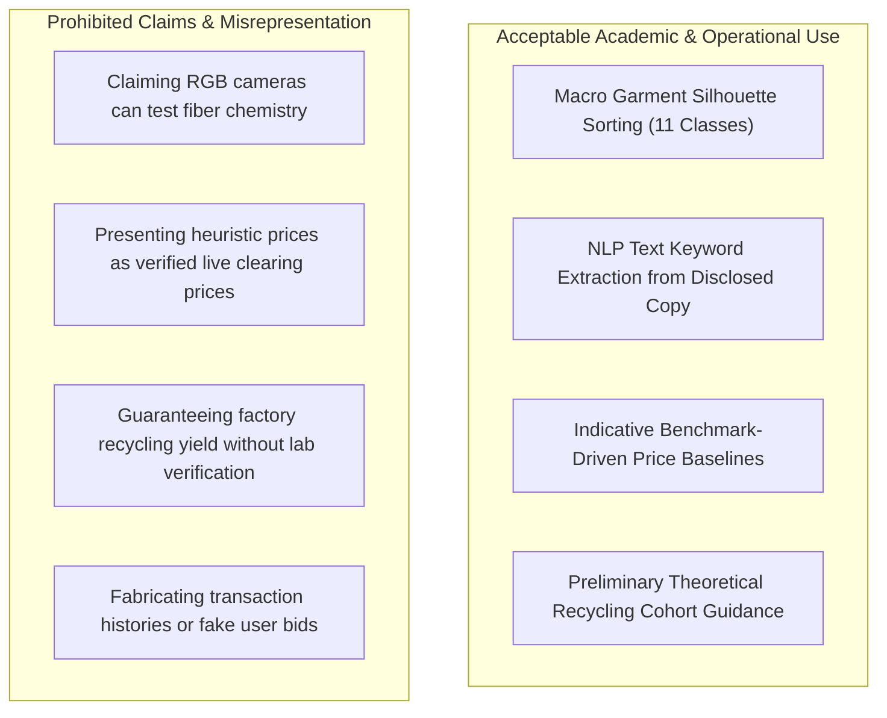

# CUTLOOP — Intellectual Property, Licencing & Ethical Compliance Note

**Document Reference:** `submission/01_startup/IP_AND_COMPLIANCE_NOTE.md`  
**Classification:** Academic Fair Use & Compliance Memorandum  

---

## 1. Intellectual Property Considerations

The software architecture, feature engineering pipelines, custom deep learning heads, and documentation comprising the CUTLOOP system were authored for the 3rd Year B.Tech 5th-Semester Integrated Assignment at JG University.

* **Core Platform Source Code:** Authored by the CUTLOOP project team under the standard MIT Open Source License, permitting non-commercial academic inspection, testing, and portfolio evaluation.
* **Algorithm & Heuristic Formulations:** The hedonic scrap valuation equations, circularity scoring rubrics, and continuous multi-component archetype cluster assignments represent novel academic expressions developed specifically for this capstone project.

---

## 2. Dataset Licences & Attribution

CUTLOOP was developed and evaluated against two publicly available empirical research datasets:

| Dataset | Provenance & Description | Original Licence | Academic Utilization Terms |
| :--- | :--- | :--- | :--- |
| **Fast-Fashion Sourced Inventory Dataset** | 47,522 garment-variant records from H&M and Uniqlo product pages (`6_JSONL_component_normalized_public.jsonl`). | Public Academic Research Dataset | Utilized strictly for non-commercial statistical analysis, NLP dominant fiber training, and K-Means clustering. Commercial reproduction of brand trade names is excluded. |
| **TexSortML Image Benchmark** | 2,252 industrial sorting photographs across 11 garment classes (`TexSortML-Pictures.zip`). | Creative Commons Attribution (CC-BY 4.0) | Utilized for deep learning computer vision transfer learning and baseline CNN benchmarking. Proper attribution is maintained in all reports. |

---

## 3. Third-Party Software & Framework Attribution

The CUTLOOP architecture incorporates several open-source libraries and frameworks, all governed by permissive licenses:

* **Java Core & Spring Boot (v3.2.x):** Apache License 2.0 (VMware / Pivotal Software).
* **Python Scientific Stack (NumPy, Pandas, Scipy):** BSD 3-Clause License.
* **Scikit-Learn (v1.5.x):** BSD 3-Clause License.
* **PyTorch & Torchvision (v2.14.x):** Modified BSD License (Meta AI / Linux Foundation).
* **FastAPI & Starlette:** MIT License (Sebastián Ramírez).
* **Bootstrap & Chart.js:** MIT License.

---

## 4. Privacy, Data Protection & User Consent
In compliance with the **Information Technology Act, 2000** and the principles of the **Digital Personal Data Protection (DPDP) Act, 2023**:
* **Credential Protection:** All user passwords are encrypted using one-way cryptographic salted hashing (BCrypt with strength 10). Plaintext passwords are never stored in databases or log streams.
* **Data Minimization:** CUTLOOP collects only the minimal operational data required for B2B marketplace discovery (company name, business email, industrial location, phone contact).
* **Role-Based Isolation:** Sellers cannot access buyer order records, and buyers cannot edit mill listings. Admin privileges are restricted via Spring Security filters.

---

## 5. Payment Gateway Test-Mode Policy

> [!IMPORTANT]
> **Simulated Sandbox Policy:**  
> To protect users and prevent unauthorized financial transactions during academic evaluation, the CUTLOOP platform executes all checkout workflows in a **Simulated Test Sandbox**.

* **Zero Real Financial Transfers:** No real credit cards, debit cards, or live UPI accounts are charged.
* **Mock Payment Processor:** The Java `PaymentProcessor` interface returns successful authorization receipts based on test credentials without connecting to live bank APIs.
* **No Stored Financial Credentials:** CVV numbers, card expiration dates, and bank account credentials are never persisted to disk or databases.

---

## 6. Ethical AI Boundaries & Limitations

In alignment with responsible AI development principles, CUTLOOP explicitly documents the boundaries of its analytical systems:

1. **No Chemical Fabric Claims:** The vision system (Model B) classifies apparel silhouettes, **not fiber chemistry**. Users are explicitly warned that an RGB photograph cannot verify whether a textile is 100% cotton or synthetic polyester.
2. **Heuristic Transparency:** Model D is labeled as an **Industrial Heuristic Estimation Engine** based on published virgin spot price benchmarks. It is never marketed as a trained empirical regression model.
3. **Preliminary Recycling Guidance:** Recycling pathway recommendations generated by Model C are classified as **preliminary theoretical targets** that require laboratory verification and mill-specific technical audits before industrial shredding or chemical processing.
