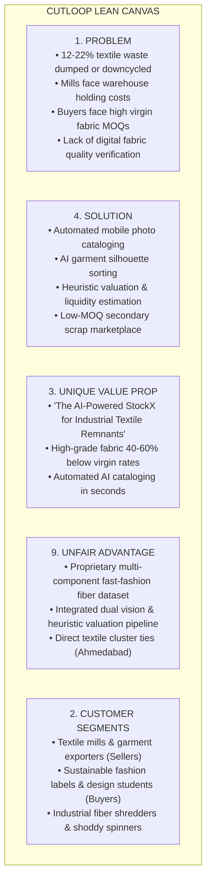

# CUTLOOP — Lean Canvas Strategy Document

**Venture:** CUTLOOP — Industrial Waste-to-Value Marketplace  
**Framework:** Ash Maurya's Lean Canvas (Problem-Focused Model)  
**Document Reference:** `submission/01_startup/LEAN_CANVAS.md`  

---

---

## The 9 Lean Canvas Sections

### 1. Problem
* Pre-consumer textile waste (12%–22% of total mill production) is treated as an illiquid operational nuisance.
* High Minimum Order Quantities (MOQs, usually 500+ meters) prevent small designers from accessing premium mills.
* Secondary textile scrap markets are informal, cash-driven, and lack standardized quality classifications.
* *Existing Alternatives:* Informal local scrap dealers ("chindi" traders), deadstock auction liquidators, dumping in municipal landfills, or open incineration.

### 2. Customer Segments
* **Primary Sellers:** Garment export factories, spinning-weaving composite mills, and cutting units in regional clusters (Ahmedabad, Surat, Tirupur).
* **Primary Buyers:** Independent sustainable fashion labels, fashion design colleges (NIFT, NID), craft studios, and circular upcycling makers.
* **Early Adopters:** Ahmedabad textile mills seeking to clear deadstock inventory and design students seeking affordable, high-grade fabrics for capstone projects.

### 3. Unique Value Proposition (UVP)
* *"One factory's leftover material is another creator's raw material."*
* An AI-driven B2B marketplace enabling factories to liquidate surplus fabric in seconds using smartphone photos, while providing creators with verified remnants at **40%–60% below virgin market rates**.

### 4. Solution
* **Mobile-First AI Cataloging:** Upload fabric photos to automatically extract categories and estimate fair market price baselines.
* **Standardized Scrap Grading:** Transparent four-tier quality framework (Grade A Deadstock, Grade B Remnants, Grade C Cutting Scraps, Grade D Shred).
* **Low-MOQ Transactions:** Purchase fabric in batch lots as low as 5 kg.
* **Preliminary Circular Guidance:** Fiber composition mapped to theoretical recycling pathways (mechanical shredding, depolymerization).

### 5. Channels
* **Direct Field Onboarding:** Student and representative outreach in GIDC industrial estates (Narol, Vatva, Odhav).
* **Digital Outreach:** Social media showcases targeting zero-waste fashion designers and sustainable textile communities.
* **Academic Partnerships:** Design institute fabrication labs and campus student makerspaces.

### 6. Revenue Streams
* **5.0% Transaction Fee:** Commission deducted from seller payout on completed escrow transactions.
* **Logistics Handling Margin:** 3%–5% markup on coordinated regional 3PL freight pickups.
* **Premium Seller Analytics (Future):** Monthly subscription for high-volume automated inventory reports and demand forecasting.

### 7. Cost Structure
* **Hosting & Compute Infrastructure:** Microservice hosting, PyTorch model inference, and database storage.
* **Platform Development & Maintenance:** Open-source software stack maintenance (Java, Python, Vue/Bootstrap).
* **Operations & Field Outreach:** Factory sample collection and student beta verification.

### 8. Key Metrics (AARRR Pirate Funnel)
* **Acquisition:** Number of registered mills and active creative buyers.
* **Activation:** Percentage of sellers completing their first fabric listing upload.
* **Retention:** Repeat order rate among sustainable fashion studios.
* **Revenue:** Gross Merchandise Value (GMV) and net transaction commission collected.
* **Referral:** Mill-to-mill word-of-mouth onboarding in industrial textile clusters.

### 9. Unfair Advantage
* Domain-specific datasets integrating **47,522 normalized fast-fashion records** and **2,252 garment benchmark images**.
* Hybrid technology stack combining **Java Spring Boot reliability** with **FastAPI Python machine learning**.
* Standardized, transparent scrap grading methodology that bridges the trust gap between industrial mills and creative designers.
