# CUTLOOP — MVP Development & Funding Roadmap

**Venture:** CUTLOOP — Industrial Waste-to-Value Platform  
**Document Reference:** `submission/01_startup/MVP_AND_FUNDING_PLAN.md`  
**Classification:** Academic Concept & Prototype Funding Framework  

---

## 1. Academic MVP Scope & Core Features

The CUTLOOP Minimum Viable Product (MVP) has been engineered as a functional, end-to-end academic prototype demonstrating technical feasibility across three primary layers:

```mermaid
flowchart LR
    subgraph Frontend_MVP["Frontend User Experience"]
        F1["Responsive Marketplace UI"]
        F2["Multi-criteria Search & Filters"]
        F3["Photo Upload & AI Inspection"]
        F4["Simulated Cart & Checkout"]
    end
    subgraph Core_MVP["Java Spring Boot Backend"]
        B1["JWT Dual-Role Auth (Buyer/Seller)"]
        B2["Material Catalog & Inventory Ledger"]
        B3["Multithreaded AI Dispatcher"]
        B4["CSV Export / Import Handler"]
    end
    subgraph AI_MVP["Data Science Microservice"]
        A1["Model A: NLP Fiber Classifier"]
        A2["Model B: TexSortML Vision Sorting"]
        A3["Model C: Composition Archetypes"]
        A4["Model D: Heuristic Valuation Engine"]
    end
    Frontend_MVP <--> Core_MVP
    Core_MVP <--> AI_MVP
```

### Core Working Features:
1. **User Authentication & Session Management:** Dual-role registration and login for Textile Mills (Sellers) and Sustainable Creators (Buyers).
2. **Interactive Listing Creation:** Sellers specify material name, scrap grade (Grade A to D), batch weight (kg), price per kg, and attach photo files.
3. **Automated AI Analysis Pipeline:**
   - **Model B:** MobileNetV2 categorizes the macro apparel silhouette (11 classes).
   - **Model A:** Random Forest extracts and classifies the dominant fiber from product text and metadata (88.15% clean accuracy).
   - **Model C:** K-Means maps fiber breakdown percentages to 5 circular archetypes and preliminary theoretical recycling pathways.
   - **Model D:** Computes an indicative baseline price ($/kg) and heuristic demand liquidity score.
4. **Marketplace Discovery & Shopping Cart:** Buyers filter listings by scrap grade, location, fiber type, and price; add items to cart; and execute simulated escrow checkout.
5. **Data Synchronization & CSV Management:** Bulk inventory export and import using standard CSV formats.

---

## 2. Development Priorities & Technical Roadmap

| Phase | Milestone | Focus Areas | Academic / Technical Status |
| :---: | :--- | :--- | :---: |
| **Phase 1** | **Core Architecture** | Schema design, Java OOP models, custom exceptions, JPA repositories | **COMPLETED** |
| **Phase 2** | **AI Microservice** | Fast-fashion dataset cleaning, TF-IDF engineering, Model A, Model B, Model C, Model D | **COMPLETED** |
| **Phase 3** | **Integrated Prototype** | Unified server proxy (`serve.py`), frontend dashboard, simulated checkout | **COMPLETED** |
| **Phase 4** | **Hardware Optimization** | CPU-efficient batching, edge-case validation, corrupted file handling | **COMPLETED** |
| **Phase 5** | **Field Pilot (Future)** | Real-world cluster pilot in Ahmedabad GIDC, live UPI integration, physical logistics | **PLANNED** |

---

## 3. Estimated Academic Prototype Budget (₹50,000 Capstone Scope)

The budget below represents the realistic capital required to transition the academic prototype into an initial verified university field trial:

| Expenditure Area | Academic Prototype (Actual) | Initial Field Pilot (Estimated) | Technical Purpose |
| :--- | :---: | :---: | :--- |
| **Cloud Hosting & Compute** | ₹0 (Localhost / Free Tier) | ₹15,000 | Lightweight VPS server + model serving storage for 6 months |
| **Domain & SSL Security** | ₹0 (Local / Netlify) | ₹2,500 | Production `.in` domain registration with standard SSL certificates |
| **Dataset Annotation & Field Trial** | ₹0 (Public Open Datasets) | ₹15,000 | Collecting and annotating physical fabric scrap swatches from local mills |
| **Entity Setup & Compliance** | ₹0 (Academic Project) | ₹12,500 | MCA incorporation as an OPC/Private Limited and GST registration |
| **Testing, Packaging & Contingency**| ₹0 | ₹5,000 | Reusable QR-coded scrap collection bags for student testers |
| **TOTAL ALLOCATION** | **₹0 (Academic Fair Use)**| **₹50,000** | **Complete Seed Stage Budget** |

---

## 4. Potential Institutional Funding Sources

1. **Gujarat Student Startup and Innovation Policy (SSIP 2.0):**
   - *Grant Size:* Up to ₹2.5 Lakhs for student-led technology prototypes.
   - *Eligibility:* Open to university engineering capstone projects demonstrating novel intellectual property and societal sustainability impact.
2. **AICTE Student Startup Assistance Grant:**
   - *Focus:* Encourages circular economy and clean computing innovations across technical institutes.
3. **Department of Science & Technology (DST) NIDHI-PRAYAS Scheme:**
   - *Grant Size:* Prototype funding up to ₹10 Lakhs through university-affiliated Technology Business Incubators (TBIs).
4. **National Institute of Fashion Technology (NIFT) Sustainable Fashion Incubation:**
   - *Focus:* Non-dilutive grants supporting circular material recovery and textile supply chain visibility.

---

## 5. DPIIT Startup India Recognition Readiness

> [!NOTE]
> **Status Disclosure:** CUTLOOP is currently an **academic capstone prototype** developed for 5th-semester evaluation. **DPIIT Startup India recognition has NOT yet been applied for or granted.**

### Preparedness Audit for Future DPIIT Application:
* **Entity Structure:** Must be incorporated as a Private Limited Company or Registered Partnership Firm (planned upon graduation).
* **Age of Entity:** Within 10 years of incorporation.
* **Turnover Threshold:** Turnover not exceeding ₹100 Crore in any financial year (currently pre-revenue).
* **Innovation & Scalability Criteria:** CUTLOOP satisfies the core criteria by offering a novel digital platform that integrates deep learning computer vision and NLP to automate secondary textile circularity, featuring high potential for regional employment creation across textile clusters.
