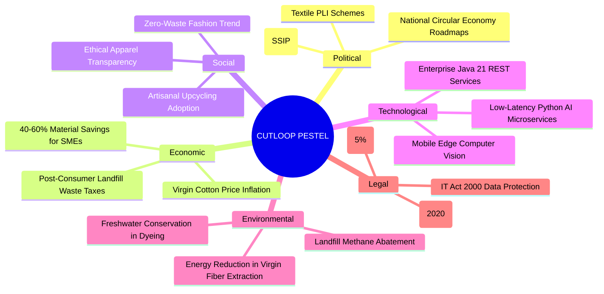

# CUTLOOP — Macro-Environmental PESTEL Analysis

**Venture:** CUTLOOP — AI-Powered Circular Textile Waste Platform  
**Document Reference:** `submission/01_startup/PESTEL_ANALYSIS.md`  

---

The PESTEL framework evaluates the external macro-environmental forces impacting CUTLOOP's viability, deployment, and future commercial scaling across India's industrial manufacturing ecosystem.

---

## 1. Political Factors
* **Circular Economy Mandates:** The Government of India's NITI Aayog circular economy committee has identified textiles as a focus sector, recommending formal digital traceability for pre-consumer waste.
* **Textile Production Linked Incentive (PLI) Scheme:** Central government incentives encourage industrial modernization and resource efficiency across textile conglomerates.
* **Innovation & Academic Incubator Support:** Generous policy frameworks, including the Startup India initiative and Gujarat Student Startup and Innovation Policy (SSIP 2.0), offer university capstones structured grant pathways.
* **Geopolitical Trade Alignments:** European Union Corporate Sustainability Due Diligence Directives (CSDDD) require Indian export garment factories to prove traceable waste reduction, driving demand for CUTLOOP's digital audit trail.

---

## 2. Economic Factors
* **Virgin Raw Material Inflation:** Fluctuations in international raw cotton and petrochemical-derived polyester prices drive micro-apparel producers toward secondary scrap remnants to maintain cost predictability.
* **SME Unit Economics:** Sourcing remnant rolls and offcuts at 40%–60% below virgin fabric spot rates significantly lowers the barrier to entry for independent fashion brands.
* **Warehouse Capital Unlock:** Eliminates dead inventory holding costs for factories, turning an unmonetized cost center into an incremental revenue channel.
* **Low Initial CapEx:** Cloud-native software architecture requires zero physical machinery installation inside mills; floor workers utilize existing company smartphones.

---

## 3. Social Factors
* **Rise of Conscious Consumerism:** Growing consumer demand among urban demographics for apparel made with verified recycled, upcycled, or zero-waste materials.
* **Thriving Craft & Upcycling Ecosystem:** A rapidly expanding network of boutique apparel designers, indie accessories creators, and craft artisans who celebrate fabric irregularities and patchwork aesthetics.
* **Educational Shift in Fashion Academics:** Premier institutes (NIFT, Pearl Academy, NID) now mandate sustainability and circular waste utilization in graduate collections.
* **Dignity of Labor:** Formalizing scrap handling elevates secondary textile management from informal dumping to a structured, digitally recognized B2B profession.

---

## 4. Technological Factors
* **Accessible Deep Learning Frameworks:** Advancements in lightweight Convolutional Neural Networks (MobileNetV2) enable inference on consumer CPUs without costly dedicated enterprise GPU clusters.
* **Ubiquitous Smartphone Penetration:** High-speed 4G/5G mobile connectivity across industrial cutting floors enables real-time high-resolution photo uploads.
* **Decoupled Microservice Interoperability:** Modern REST APIs and async event handling bridge Java enterprise transactional robustness with Python's data science ecosystem.
* **Digital Public Infrastructure (India Stack):** Future commercial integration with UPI, ONDC (Open Network for Digital Commerce), and Aadhaar-based GST verification streamlines supplier onboarding.

---

## 5. Environmental Factors
* **Landfill Methane Abatement:** Diverting cotton and organic textile scraps from open dumping prevents anaerobic decomposition and subsequent greenhouse gas (methane) emissions.
* **Massive Freshwater Savings:** Reusing pre-consumer fabric completely bypasses the agricultural water footprint of virgin cotton farming (~10,000 to 20,000 liters of water per kilogram of virgin cotton).
* **Chemical Pollution Mitigation:** Eliminates secondary chemical dyeing, bleaching, and scouring processes by utilizing already-dyed surplus offcuts as ready-to-sew materials.
* **Prolonged Material Lifecycles:** Postpones premature downcycling into low-value shoddy filler, maximizing the functional economic lifespan of virgin fibers.

---

## 6. Legal & Regulatory Factors
* **E-Commerce Marketplace Guidelines:** CUTLOOP adheres to the Consumer Protection (E-Commerce) Rules, 2020, mandating clear seller disclosure, terms of trade, transparent pricing, and dispute redressal.
* **GST on Secondary Textiles:** Fabric offcuts, remnants, and rags are classified under HSN Code 6310 with a standard 5% GST bracket; CUTLOOP provides compliant invoice reporting.
* **Information Technology Act, 2000 & DPDP Act, 2023:** Secure handling of user credentials, password encryption (BCrypt), and role-based data isolation.
* **Contractual Escrow Framework:** Clear buyer-seller trade terms outlining scrap grading thresholds to protect against fraudulent claims of misrepresentation.
