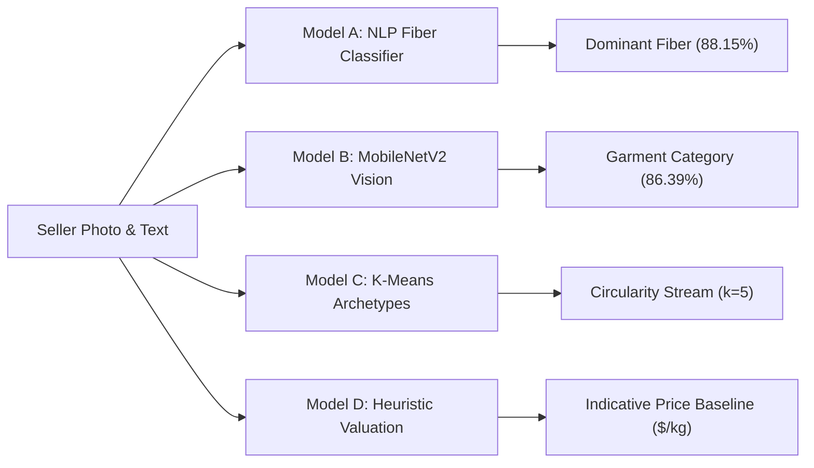

# CUTLOOP — Academic Project Proposal & Startup Concept Note

**Project Title:** CUTLOOP — AI-Powered Circular Industrial Textile Waste-to-Value Platform  
**Program:** 3rd Year B.Tech CSE (5th Semester Integrated Capstone)  
**Academic Year:** 2026–2027  
**Institution:** JG University  
**Subject Track:** Startup & Entrepreneurship Policies (10 Marks) + Capstone Foundation  

---

## 1. Problem Statement
In industrial textile manufacturing clusters (e.g., Ahmedabad, Surat, Tirupur, and Ludhiana), between **12% and 22% of virgin fabric is discarded as pre-consumer industrial waste** during the pattern cutting, batch sampling, and roll-end finishing stages. 

Textile mills and garment export houses face significant logistical friction:
1. **Holding & Depreciation Costs:** Leftover fabric remnants, deadstock rolls, and cutting scraps occupy valuable mill floor space and incur holding costs.
2. **Information Asymmetry:** Micro-creators, design students, and boutique upcycling labels need small-batch raw materials at affordable prices, but lack a trusted, transparent mechanism to verify fabric composition, grade, and defect status remotely.
3. **Environmental Downcycling:** Due to the absence of automated sorting and transparent digital channels, high-grade surplus fabric is routinely incinerated, dumped in municipal landfills, or downcycled into low-grade industrial insulation.

---

## 2. Background and Motivation
India is the world's second-largest textile and apparel exporter, yet secondary textile waste handling remains overwhelmingly informal and unorganized. Informal scrap dealers ("chindi" traders) operate with cash-only transactions, opaque pricing, and zero digital provenance.

With the Government of India's increased emphasis on circular economy roadmaps, Extended Producer Responsibility (EPR) in textiles, and ESG compliance, there is an urgent need for an **accessible, digital Waste-to-Value B2B platform**. 

**CUTLOOP** addresses this structural market failure by providing an AI-assisted digital marketplace that connects industrial textile mills directly with creative and commercial recyclers.

---

## 3. Target Users & Stakeholders

| User Segment | Typical Profile | Pain Points Addressed |
| :--- | :--- | :--- |
| **Primary Sellers** | Textile composite mills, garment export houses, cutting units | Illiquid inventory, uncataloged remnants, zero secondary market transparency |
| **Primary Buyers** | Sustainable boutique brands, fashion students, craft artisans, upcycling studios | Minimum Order Quantity (MOQ) barriers for virgin fabric, high raw material costs |
| **Circular Aggregators** | Industrial shredders, shoddy yarn spinners, non-woven batt manufacturers | Mixed uncharacterized fiber bales, contamination risks in recycling |

---

## 4. Proposed Solution
CUTLOOP is an integrated digital platform combining a **Java enterprise backend**, **Python Data Science and Machine Learning microservices**, and an **interactive web marketplace**:
- **Automated Cataloging:** Sellers photograph remnant fabrics and input physical weights.
- **Vision Silhouette Sorting (Model B):** Classifies the macro garment silhouette (11 apparel classes).
- **Dominant Fiber & Material Inference (Model A):** Extracts declared textile fiber categories from listing copy using NLP text classification.
- **Continuous Composition Archetype Clustering (Model C):** Groups multi-fiber blends into 5 distinct circular recycling archetypes.
- **Heuristic Valuation Engine (Model D):** Estimates an indicative fair market price ($/kg) and demand liquidity score based on published commodity benchmarks and physical scrap multipliers.

---

## 5. Main Objectives
1. **Automate Surplus Discovery:** Eliminate manual physical inspections by providing AI-driven categorization and fiber extraction.
2. **Standardize Scrap Grading:** Establish transparent quality classifications (Grade A Deadstock, Grade B Remnants, Grade C Cutting Scraps, Grade D Shred).
3. **Encourage Circular Recycling:** Map fiber compositions to preliminary theoretical recycling streams (mechanical shredding, chemical depolymerization, dissolving pulp).
4. **Demonstrate Technical Integration:** Provide a working academic prototype combining Java OOP, REST APIs, multithreading, scikit-learn models, and PyTorch deep learning.

---

## 6. Scope & Academic Boundaries
- **In Scope:**
  - Prototype B2B e-commerce platform with buyer/seller authentication, search, filtering, cart, order management, and simulated checkout.
  - Data science pipelines analyzing 47,522 garment records and 2,252 benchmark images.
  - Integration of 4 analytical models with documented operational boundaries.
- **Out of Scope (Academic Exclusions):**
  - Live bank payment gateway integration (operates strictly in test/simulated sandbox mode).
  - Physical warehouse logistics and real-time GPS freight tracking.
  - Enterprise ERP integration for industrial factory accounting.

---

## 7. Planned AI/ML Features

1. **Model A:** Random Forest classifier predicting dominant fiber class (88.15% clean held-out accuracy).
2. **Model B:** MobileNetV2 deep learning model classifying 11 garment categories (86.39% accuracy).
3. **Model C:** K-Means unsupervised clustering grouping blends into 5 circular archetypes (0.6686 silhouette score).
4. **Model D:** Heuristic benchmark estimation model calculating indicative clearing valuations.

---

## 8. Expected Outcomes
1. A fully functioning, interactive academic prototype accessible via web browser.
2. Verified reproducible machine learning models trained on public empirical datasets.
3. Complete technical documentation adhering to 5th-semester academic evaluation criteria.
4. Foundation for future incubation under academic innovation grants or state student startup policies.
