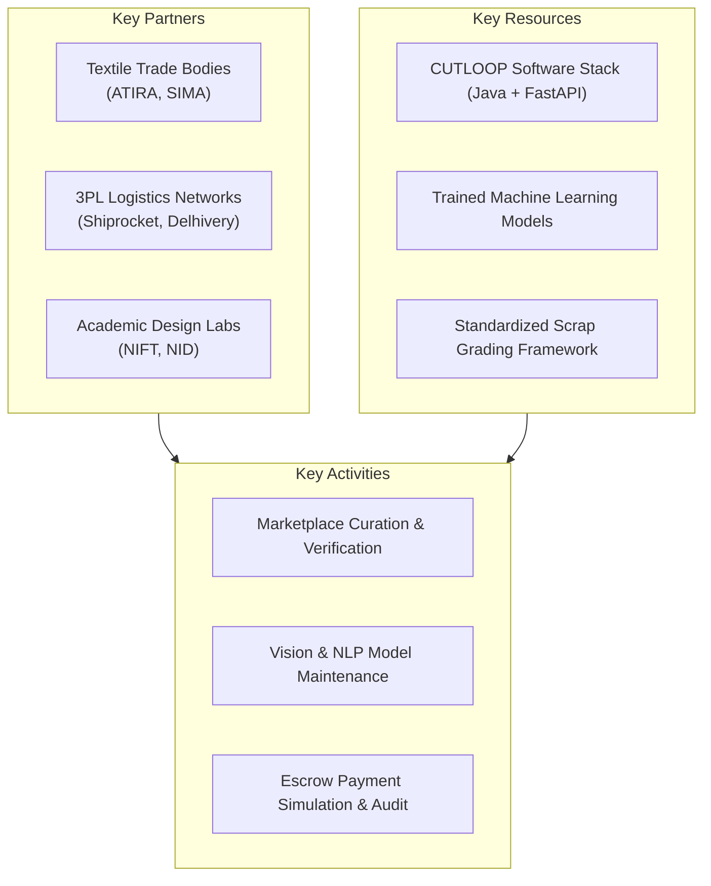

# CUTLOOP — Startup Business Plan (Academic Portfolio Concept)

**Document Reference:** `submission/01_startup/STARTUP_BUSINESS_PLAN.md`  
**Venture Name:** CUTLOOP Technologies (Academic Prototype)  
**Industry:** ClimateTech / Industrial Textile Circular Economy / B2B E-Commerce  

---

## 1. Startup Overview
CUTLOOP is an academic startup concept proposing a specialized B2B marketplace to monetize industrial pre-consumer textile waste. By connecting textile composite mills with boutique designers, upcycling enterprises, and circular fiber processors, CUTLOOP transforms costly warehouse scrap into high-value raw material.

---

## 2. Vision & Mission
* **Vision:** To become the standard digital operating system for pre-consumer textile surplus across South Asia, diverting 100,000 tons of fabric waste from landfills annually by 2030.
* **Mission:** Empower manufacturers with automated, AI-assisted cataloging to achieve rapid inventory liquidity while providing creators and circular recyclers with verified, affordable, and traceable secondary textiles.

---

## 3. Customer Segments & Value Proposition

### 3.1 Sellers (Textile Mills & Garment Manufacturers)
* **Profile:** Composite spinning-weaving mills, garment exporters, and contract cutting units in regional clusters (Ahmedabad, Surat, Tirupur).
* **Core Pain Points:** High warehouse storage costs, lack of digital cataloging infrastructure, loss of capital locked in surplus fabric offcuts.
* **CUTLOOP Value Proposition:**
  * **Instant Cataloging:** Rapid mobile upload with automated category classification.
  * **Fast Liquidity:** Direct access to verified buyers willing to purchase smaller remnant lots.
  * **Secondary Revenue:** Monetization of materials previously sold at depressed scrap rates.

### 3.2 Buyers (Designers, SME Brands & Circular Recyclers)
* **Profile:** Sustainable apparel labels, zero-waste designers, design students, and industrial fiber recyclers.
* **Core Pain Points:** High Minimum Order Quantities (MOQs) for virgin fabric, lack of fiber composition transparency, high raw material costs.
* **CUTLOOP Value Proposition:**
  * **Low MOQs:** Ability to purchase verified fabric rolls and remnants in lots as small as 5 kg.
  * **Cost Advantage:** High-grade virgin surplus priced at 40%–60% below virgin market rates.
  * **Transparent Profiling:** AI-assisted category and composition profiling with indicative quality grading.

---

## 4. Revenue Model
CUTLOOP operates a multi-stream B2B marketplace monetization strategy:

1. **Transaction Commission (Core):** A baseline **5.0% transaction fee** charged on all completed marketplace orders, paid by the seller upon escrow clearing.
2. **Logistics & Aggregation Margin:** 3%–5% markup on coordinated regional 3PL freight and palletized freight logistics.
3. **Premium Factory Analytics Tier (Proposed Future):** A subscription model (₹1,999/month) for large mills offering advanced inventory reporting, demand forecasting alerts, and automated CSV inventory synchronization.

---

## 5. Cost Structure
The cost architecture is split between prototype development and commercial operating assumptions:

| Cost Component | Prototype Stage (Academic) | Commercial MVP Stage (Projected) |
| :--- | :--- | :--- |
| **Cloud Hosting & Compute** | Localhost / Free Tier Cloud (₹0) | AWS/GCP Microservices & GPU inference (₹15,000/mo) |
| **Domain & SSL Security** | Staging / Local testing (₹1,500) | Commercial Domain, Wildcard SSL, DDoS Shield (₹5,000/yr) |
| **Developer Tooling & Models**| Open-source Python & Java (₹0) | Continuous retraining compute & storage (₹10,000/mo) |
| **Field Outreach & Operations**| Student network testing (₹0) | Cluster onboarding representative (₹25,000/mo) |
| **Compliance & Legal** | Academic fair use | GST registration, Private Limited incorporation (₹15,000 one-time) |

---

## 6. Key Partners, Resources & Activities

* **Key Partners:** Regional textile associations, third-party logistics carriers, design institutes, and regional recycling aggregators.
* **Key Resources:** Proprietary software architecture, trained deep learning weights, curated multi-component fiber datasets, and standardized scrap grading rules.
* **Key Activities:** Supplier onboarding, automated visual quality moderation, platform uptime maintenance, and escrow transaction handling.

---

## 7. MVP Scope & Milestones
- **Milestone 1 (Month 1–2 - Completed):** Core Java Spring Boot architecture, PostgreSQL/MySQL schema, dual-role authentication, and product cataloging.
- **Milestone 2 (Month 3–4 - Completed):** FastAPI integration, Model A dominant fiber classifier, Model B MobileNetV2 garment classifier, Model C K-Means clustering, and Model D valuation baseline.
- **Milestone 3 (Month 5 - Completed):** Integrated frontend interface, end-to-end simulated ordering, edge-case hardening, and academic documentation.
- **Milestone 4 (Future Commercialization):** Incorporation as a Private Limited entity, DPIIT Startup India application, and physical pilot in Ahmedabad GIDC cluster.
