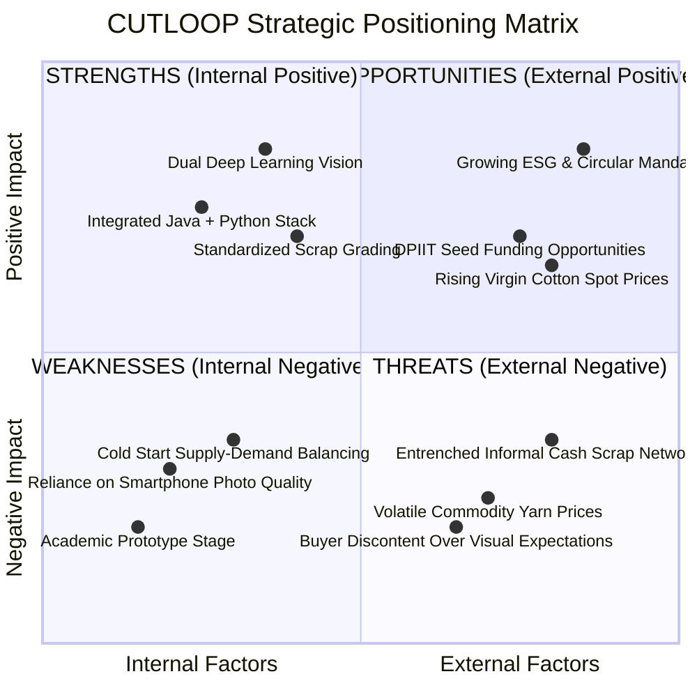

# CUTLOOP — Comprehensive SWOT Analysis

**Venture:** CUTLOOP — Industrial Waste-to-Value Marketplace  
**Document Reference:** `submission/01_startup/SWOT_ANALYSIS.md`  

---

---

## 1. Strengths (Internal Positive Attributes)
1. **Hybrid High-Performance Architecture:** Combines an enterprise-grade Java 21 Spring Boot core with lightweight Python FastAPI machine learning services, ensuring sub-50ms transaction latency.
2. **Dual-Model Deep Learning & NLP Pipelines:** Incorporates verified, reproducible models for dominant fiber extraction (88.15% accuracy) and macro garment category classification (86.39% accuracy).
3. **Transparent Quality Standards:** Introduces a formal 4-tier grading taxonomy (Grade A to D) and preliminary circular recycling recommendations that solve the trust deficit in secondary scrap.
4. **Zero-Friction Prototype Deployment:** Delivered via a self-contained unified proxy server (`serve.py`) requiring minimal developer friction and zero complex container overhead for evaluation.
5. **Clear Operational Boundaries:** Grounded in honest, documented model limitations (explicitly distinguishing heuristic valuations from empirical transactions and macro categories from chemical fiber testing).

---

## 2. Weaknesses (Internal Vulnerabilities)
1. **Academic Prototype Constraints:** The current system operates with simulated mock payment gateways and in-memory/H2 testing data; physical fulfillment logistics are not yet integrated into live transport APIs.
2. **Dependence on Image Quality:** Model B classification accuracy can degrade if sellers upload blurry, poorly lit, or heavily folded textile scrap photos.
3. **Lack of Empirical Transaction Datasets:** Model D pricing operates as a heuristic benchmark model derived from published virgin commodity spot rates rather than econometric regression on historical clearing prices.
4. **Small Academic Team:** Limited operational bandwidth to conduct continuous in-person factory inspections across geographically dispersed textile clusters.
5. **Cold-Start Marketplace Dynamics:** Simultaneous onboarding of sellers (factories) and buyers (designers) in a localized geographic cluster requires active manual seeding.

---

## 3. Opportunities (External Favorable Trends)
1. **Regulatory Tailwinds (Circular Economy Guidelines):** The Ministry of Textiles and Ministry of Environment, Forest and Climate Change (MoEFCC) are actively formalizing Extended Producer Responsibility (EPR) frameworks for industrial textiles.
2. **Inflation in Virgin Fiber Commodities:** Surges in virgin cotton and synthetic yarn prices compel small apparel studios to seek secondary remnant alternatives to preserve gross margins.
3. **Surging Sustainable Consumerism:** Growing global demand for zero-waste, patchwork, and upcycled fashion garments among Gen-Z and millennial demographics.
4. **Institutional Startup Support:** Eligibility for student startup funding initiatives, such as the Gujarat Student Startup & Innovation Policy (SSIP 2.0) and DPIIT Startup India Seed Fund Scheme.
5. **Expansion to Adjacent Industrial Waste Streams:** Potential to adapt the sorting and valuation engine to leather offcuts, technical automotive non-wovens, and industrial packaging textiles.

---

## 4. Threats (External Risks & Challenges)
1. **Entrenched Informal "Chindi" Networks:** Local, unorganized scrap brokers operate with instantaneous cash payouts and minimal tax compliance, resisting formal digital transitions.
2. **Commodity Price Volatility:** Sharp drops in virgin polyester or cotton yarn prices can narrow the price-advantage window of secondary textile waste.
3. **Dispute Risks on Material Conditions:** Risk of buyer-seller friction regarding color variations, residual odor, or minor hidden defects in cutting table remnants.
4. **Logistics Cost Inefficiencies:** High per-kilogram freight costs for small, bulky fabric remnant parcels can diminish the financial savings for regional buyers.
5. **Skepticism from Factory Management:** Conservative traditional mill floor managers may be hesitant to train cutting room staff to photograph and weigh scrap digitally.

---

## 5. Strategic Synthesis & Action Matrix (TOWS)

* **SO Strategy (Strengths + Opportunities):** Leverage the verified deep learning classification engine and student startup grants (SSIP 2.0) to launch an initial pilot in Ahmedabad's Narol GIDC cluster, establishing digital traceability for export mills.
* **WO Strategy (Weaknesses + Opportunities):** Partner with local design institutes (NIFT Gandhinagar) to guarantee early buyer demand, while applying for academic innovation funding to transition from simulated escrow to live banking APIs.
* **ST Strategy (Strengths + Threats):** Emphasize transparent scrap grading and instant digital listing speed to out-compete informal cash brokers who lack quality guarantees.
* **WT Strategy (Weaknesses + Threats):** Implement conservative heuristic pricing floors with prominent buyer disclaimers to prevent visual expectation mismatches and minimize dispute risks.
