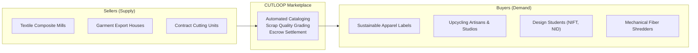
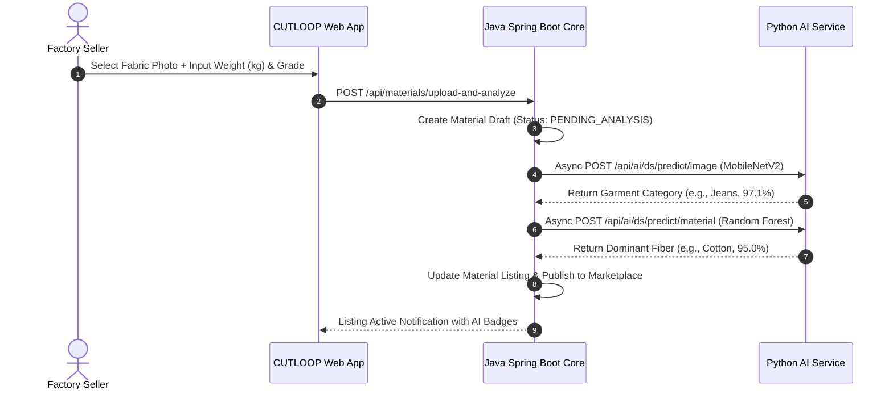
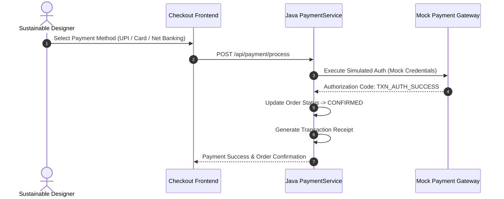
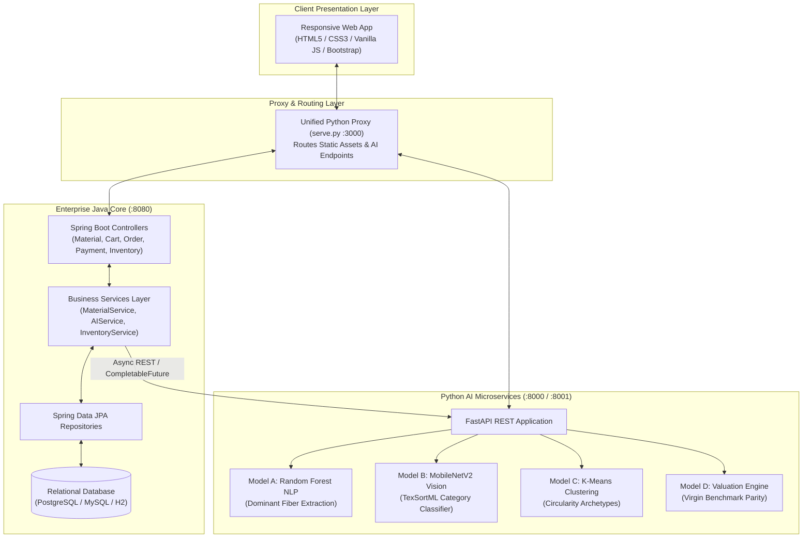
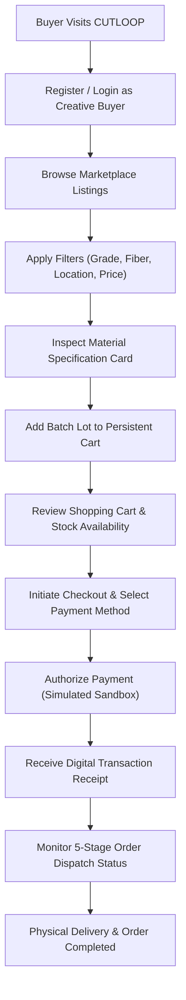
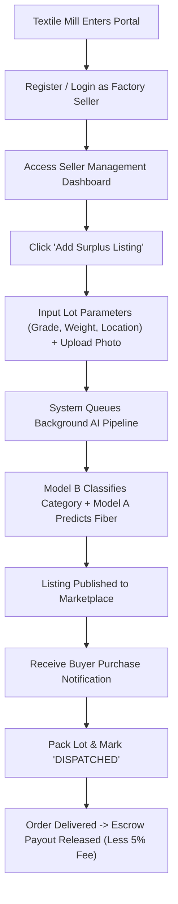

# CUTLOOP — E-Commerce Design & System Architecture Document

**Document Reference:** `submission/02_ecommerce/ECOMMERCE_DESIGN_DOCUMENT.md`  
**Academic Subject:** E-Commerce & Web Platforms (10 Marks)  
**Program:** 3rd Year B.Tech CSE (5th Semester Integrated Capstone)  
**System Evaluated:** CUTLOOP — Industrial Circular Textile Waste Marketplace  

---

## 1. Platform Overview
CUTLOOP is an AI-assisted B2B circular e-commerce platform designed to monetize industrial pre-consumer textile waste. It connects textile composite mills and garment export factories with boutique sustainable brands, craft studios, and circular recyclers. The platform transforms uncataloged, illiquid cutting scraps and surplus deadstock rolls into transparently graded, commercially accessible raw material.

---

## 2. Business Model
CUTLOOP operates a **two-sided B2B managed marketplace model**:
* **Supply Side (Sellers):** Textile mills and garment cutting units list surplus fabrics, remnant rolls, and factory cut-offs.
* **Demand Side (Buyers):** Upcycling studios, sustainable fashion labels, and circular yarn recyclers discover and purchase small-batch textile waste.
* **Platform Value-Add:** AI-assisted category classification, dominant fiber extraction, circularity archetype clustering, and standardized scrap quality grading.

---

## 3. Target Buyers & Sellers

* **Sellers:** Mills in textile hubs (Ahmedabad, Surat, Tirupur, Ludhiana) seeking rapid inventory liquidity and lower holding costs.
* **Buyers:** Independent sustainable fashion designers, student makers, and circular recyclers seeking affordable fabric with low Minimum Order Quantities (MOQs as low as 5 kg).

---

## 4. Buyer Registration & Login Workflow
1. **Account Creation:** Buyer submits company/studio name, contact person, email, and password via the registration portal.
2. **Role Assignment:** System assigns `BUYER` role and creates an empty persistent shopping cart.
3. **Authentication:** Spring Security verifies credentials using BCrypt salted hashing and issues a session token.
4. **Buyer Dashboard:** Grants access to marketplace browsing, saved wishlist items, active cart, and order history.

---

## 5. Seller Registration & Login Workflow
1. **Mill Onboarding:** Factory representative submits mill name, industrial location (e.g., Narol GIDC, Ahmedabad), business email, and phone contact.
2. **Role Assignment:** System registers the entity under the `SELLER` role.
3. **Authentication:** Authenticated via Spring Security with access to the Seller Management Hub.
4. **Seller Operations:** Ability to publish listings, view real-time AI classification results, review incoming buyer orders, and export inventory CSV reports.

---

## 6. Product / Textile Listing Workflow

1. **Listing Entry:** Seller uploads a clear fabric swatch or scrap photo and specifies lot weight (kg), surplus grade (Grade A to D), and target price per kg.
2. **Draft Persistence:** Java backend persists the listing entity with status `PENDING_ANALYSIS`.
3. **Multithreaded AI Dispatch:** `AIService` asynchronously submits image bytes to the Python FastAPI microservice.
4. **Classification & Verification:**
   - **Model B:** Categorizes macro apparel silhouette (e.g., jacket, jeans, shirt).
   - **Model A:** Classifies dominant textile fiber (cotton, polyester, wool, etc.).
   - **Model C:** Maps fiber composition to circularity archetypes.
   - **Model D:** Provides indicative benchmark clearing valuation ($/kg).
5. **Catalog Publication:** Listing status transitions to `ACTIVE`, becoming instantly searchable across the buyer marketplace.

---

## 7. Search & Discovery Architecture
* **Multi-Criteria Filtering:** Buyers filter surplus lots by:
  - **Textile Fiber:** Cotton, Polyester, Polyamide, Wool, Linen, Silk, Blends.
  - **Scrap Grade:** Grade A (Deadstock Rolls), Grade B (Remnants), Grade C (Cutting Scraps), Grade D (Shred).
  - **Manufacturing Hub:** Ahmedabad, Surat, Tirupur, Ludhiana, Jaipur.
  - **Price Range:** Maximum price slider (₹/kg or \$/kg).
* **Search Optimization:** In-memory indexed search matching keywords across material names, descriptions, and factory tags.

---

## 8. Product Details & Transparency Card
Each active listing displays a comprehensive specification card:
- High-resolution photograph with zoom inspection.
- Scrap Quality Grade badge with physical definition.
- Lot size (total kg available and Minimum Order Quantity).
- Extracted fiber composition and preliminary circular recycling recommendations.
- Indicative benchmark valuation comparison.
- Verified factory location and shipping origin.

---

## 9. Cart & Order Management
* **Persistent Shopping Cart:** Stored in the backend database (`Cart` and `CartItem` entities) linked to the buyer's account.
* **Real-Time Stock Validation:** `InventoryService` verifies available stock before items can be added to cart.
* **Order Creation:** On checkout initiation, cart items convert into immutable `Order` and `OrderItem` records.
* **Automated Stock Deduction:** System deducts purchased weight from available inventory:
  $$\text{Available Stock}_{\text{new}} = \text{Available Stock}_{\text{current}} - \text{Ordered Weight}_{\text{kg}}$$
* **Order Status Tracking:** 5-stage status lifecycle (`PENDING` $\rightarrow$ `CONFIRMED` $\rightarrow$ `PROCESSING` $\rightarrow$ `DISPATCHED` $\rightarrow$ `DELIVERED`).

---

## 10. Checkout & Payment Approach (Simulated Test Sandbox)

* **Academic Sandbox Policy:** All payments execute in a **Simulated Test Mode**. No live credit cards or bank accounts are debited.
* **Supported Simulated Payment Methods:**
  - **Instant UPI:** Dynamic QR code simulation with virtual VPA validation.
  - **B2B Cards:** Simulated Visa/Mastercard/RuPay processing with mock CVV validation.
  - **Net Banking:** Simulated corporate portal authentication (SBI, HDFC, ICICI).
  - **Industrial NEFT Escrow:** Virtual escrow settlement simulation for large commercial lots.
* **Receipt Generation:** Generates a downloadable digital transaction voucher containing order ID, timestamp, items, GST breakup, and shipment tracking code.

---

## 11. Logistics & Delivery Plan
* **B2B Freight Strategy:** Remnant fabrics range from 10 kg bundles to 500 kg palletized rolls.
* **Standard 3PL Integration (Proposed Future):** Partnerships with freight aggregators (Delhivery B2B, V-Trans, Blue Dart) providing surface cargo pickups directly from factory gates.
* **Regional Hub Consolidation:** Grouping small cuttings from adjacent Ahmedabad mills (Narol/Vatva) to achieve full truckload (FTL) freight efficiencies.

---

## 12. Revenue Model
* **5.0% Marketplace Commission:** Automatically deducted from seller payouts upon confirmed buyer delivery.
* **Logistics Handling Margin:** 3%–5% operational markup on integrated third-party shipping arrangements.
* **Factory SaaS Tier (Proposed Future):** Monthly subscription (₹1,999/mo) for automated CSV inventory synchronization and regional seasonal demand alerts.

---

## 13. Digital Marketing Strategy
* **Direct Field Onboarding:** Representatives engaging production managers in GIDC industrial estates (Gujarat).
* **Fashion Institute Partnerships:** Design competitions and sponsored fabric grants at NIFT, NID, and Pearl Academy.
* **Content & Social Media:** Zero-waste design showcases, before-and-after upcycling tutorials, and carbon-reduction calculators on Instagram and LinkedIn.
* **SEO Optimization:** Target keywords: *"buy textile waste Ahmedabad"*, *"surplus fabric remnants wholesale"*, *"deadstock fabric India"*.

---

## 14. Privacy & Data Protection
* **Data Minimization:** Collects only essential operational data (company name, business email, location, phone).
* **Password Encryption:** Salted one-way hashing with **BCrypt (strength 10)**. Plaintext passwords are never stored or logged.
* **Data Isolation:** Enforced tenancy rules ensuring sellers cannot view competitor listings or buyer financial records.

---

## 15. Security Measures
* **Cross-Origin Resource Sharing (CORS):** Strict CORS policies restricting API access to trusted frontend origins.
* **Injection Prevention:** Spring Data JPA / Hibernate parameterized queries completely prevent SQL injection attacks.
* **Input Sanitization:** Multi-layer input validation rejecting malformed payloads, oversized file uploads, and corrupted image bytes.
* **Secure Communications:** HTTPS encryption for all external API endpoints.

---

## 16. Fake Review & Sybil Prevention
* **Verified Buyer Verification:** Reviews and seller ratings can **only** be submitted by registered buyers with a confirmed `DELIVERED` order status for that specific listing.
* **Rate Limiting:** One review per transaction ID prevents review flooding.
* **Cryptographic Transaction Receipts:** Every review references an immutable order hash in the database.

---

## 17. Dark-Pattern Avoidance
CUTLOOP is engineered in strict compliance with consumer protection guidelines, deliberately avoiding manipulative UI patterns:
- **No Hidden Fees:** Total order cost including freight and 5% GST is clearly displayed on the product page before cart addition.
- **No Sneak-into-Cart:** No pre-selected insurance add-ons, donations, or extra items are injected into the buyer's basket.
- **Transparent Countdown Clocks:** No artificial urgency countdown timers or fabricated stock scarcity warnings (*"Only 1 left!"*).
- **Clear Disclaimers:** All AI valuation estimates are explicitly badged as heuristic guidelines rather than guaranteed resale prices.

---

## 18. Functional & Non-Functional Requirements

### Functional Requirements:
1. System shall allow buyers and sellers to register and authenticate securely.
2. System shall allow sellers to create material listings with photos and batch parameters.
3. System shall asynchronously classify uploaded fabric images into 11 garment categories.
4. System shall classify dominant fiber from title and description with $>85\%$ test accuracy.
5. System shall calculate heuristic benchmark clearing prices based on published virgin spot rates.
6. System shall support multi-parameter filtering and shopping cart persistence.
7. System shall simulate escrow payment authorization and deduct purchased inventory.
8. System shall support bulk CSV export and import for inventory synchronization.

### Non-Functional Requirements:
1. **Performance:** Sub-100ms API response time for catalog browsing; sub-50ms inference latency for vision classification on CPU.
2. **Reliability:** Graceful error handling for missing models, invalid payloads, and corrupted files.
3. **Usability:** Responsive layout supporting both factory mobile smartphones and studio desktop screens.
4. **Maintainability:** Decoupled modular architecture separating Java transaction logic from Python machine learning pipelines.
5. **Portability:** Self-contained execution on standard developer laptops without requiring enterprise GPU clusters.

---

## 19. Complete System Architecture & User Journey Diagrams

### 19.1 Comprehensive System Architecture

### 19.2 End-to-End Buyer Journey

### 19.3 End-to-End Seller Journey

