# CUTLOOP — Java Enterprise Application Technical Documentation

**Document Reference:** `submission/03_java/JAVA_TECHNICAL_DOCUMENTATION.md`  
**Subject Track:** Java Core & Enterprise Backend (20 Marks)  
**Language & Platform:** Java 21 LTS / Spring Boot 3.2.x  
**Academic Program:** 3rd Year B.Tech CSE (5th Semester Integrated Capstone)  

---

## 1. Application Overview
The **CUTLOOP Java Enterprise Backend** manages core transactional integrity, persistent user sessions, relational inventory ledgers, and multithreaded AI service orchestration for the marketplace. Built using modern Java 21 features (records, enhanced pattern matching, virtual threads compatibility) and the Spring Boot framework, it provides secure, high-throughput REST APIs connecting the frontend interface with Python machine learning microservices.

---

## 2. System Architecture & Layered Design

```mermaid
flowchart TD
    subgraph Presentation_Layer["1. Controller / Presentation Layer"]
        C1["AuthController (:8080/api/auth)"]
        C2["MaterialController (:8080/api/materials)"]
        C3["CartController (:8080/api/cart)"]
        C4["OrderController (:8080/api/orders)"]
        C5["PaymentController (:8080/api/payment)"]
        C6["InventoryController (:8080/api/inventory)"]
    end

    subgraph Service_Layer["2. Business Service & Logic Layer"]
        S1["UserService"]
        S2["MaterialService"]
        S3["CartService"]
        S4["OrderService"]
        S5["PaymentService (implements PaymentProcessor)"]
        S6["InventoryService (CSV Export/Import)"]
        S7["AIService (@Async Multithreaded REST Client)"]
    end

    subgraph Data_Access_Layer["3. Data Access & Repository Layer"]
        R1["UserRepository"]
        R2["MaterialRepository"]
        R3["CartRepository"]
        R4["OrderRepository"]
        R5["PaymentRepository"]
        R6["InventoryRepository"]
        R7["AIAnalysisRepository"]
    end

    subgraph Storage_Layer["4. Storage & Persistence"]
        DB[("Relational Database<br/>PostgreSQL / MySQL / H2")]
        Files["File System Storage<br/>(CSV Exports & Uploaded Swatches)"]
    end

    Presentation_Layer --> Service_Layer
    Service_Layer --> Data_Access_Layer
    Data_Access_Layer --> Storage_Layer
```



---

## 3. Package Structure & Class Organization

The backend adheres to a strict clean-architecture package taxonomy under `com.cutloop`:

```text
com.cutloop/
├── config/
│   ├── AsyncConfig.java             # Thread pool configuration (cutloopAsyncExecutor)
│   ├── DataInitializer.java         # Seed data loader for testing
│   └── SecurityConfig.java          # Spring Security, BCrypt, CORS filters
├── controller/
│   ├── AdminController.java         # Platform moderation endpoints
│   ├── AuthController.java          # Dual-role registration & login
│   ├── CartController.java          # Cart items management
│   ├── HealthController.java        # Backend health check
│   ├── InventoryController.java     # Stock queries & CSV export/import
│   ├── MaterialController.java      # Listing upload, search & matching
│   ├── OrderController.java         # Checkout & order status tracking
│   └── PaymentController.java       # Simulated payment processing
├── dto/
│   └── OrderRequest.java            # Request transfer objects
├── exception/
│   ├── InsufficientStockException.java # Stock depletion error
│   ├── InvalidMaterialException.java   # Bad scrap grade / parameter
│   └── PaymentFailedException.java     # Gateway authorization failure
├── model/
│   ├── User.java                    # Base user entity
│   ├── Buyer.java                   # Extends User (Buyer profile)
│   ├── Seller.java                  # Extends User (Mill profile)
│   ├── Admin.java                   # Extends User (Moderator profile)
│   ├── Material.java                # Surplus textile entity
│   ├── MaterialImage.java           # Associated image assets
│   ├── MaterialStatus.java          # Listing lifecycle enum
│   ├── Cart.java                    # Shopping cart entity
│   ├── CartItem.java                # Line item entity
│   ├── Order.java                   # Order entity
│   ├── OrderItem.java               # Purchased order line item
│   ├── OrderStatus.java             # Order logistics enum
│   ├── Payment.java                 # Financial transaction record
│   ├── PaymentStatus.java           # Payment state enum
│   ├── Inventory.java               # Physical stock tracker
│   ├── AIAnalysis.java              # Vision & NLP prediction store
│   └── UserRole.java                # Security role enum
├── repository/                      # Spring Data JPA repositories
└── service/
    ├── AIService.java               # Multithreaded AI dispatcher
    ├── CartService.java             # Shopping cart business logic
    ├── InventoryService.java        # Inventory ledger & CSV I/O
    ├── MaterialService.java         # Listing lifecycle & search
    ├── OrderService.java            # Order workflow & stock locking
    ├── PaymentProcessor.java        # Interface for payment strategy
    ├── PaymentService.java          # Payment processing implementation
    └── UserService.java             # Account creation & auth verification
```

---

## 4. Object-Oriented Programming (OOP) Implementation

### 4.1 Encapsulation
All domain model fields are declared `private` or `protected`, with state accessed and modified exclusively through Lombok-generated accessors/mutators (`@Getter`, `@Setter`) and defensive builder patterns (`@Builder`).

### 4.2 Inheritance Hierarchy
CUTLOOP utilizes OOP inheritance to model user roles cleanly:
* `User` is the base mapped entity containing core attributes (`id`, `fullName`, `email`, `passwordHash`, `role`, `createdAt`).
* `Buyer extends User`: Inherits base credentials while adding buyer-specific attributes (`shippingAddress`, `organizationType`, `totalOrdersPlaced`, `preferredFabrics`).
* `Seller extends User`: Inherits base credentials while adding industrial factory attributes (`companyName`, `gstNumber`, `warehouseCity`, `isVerifiedMill`).
* `Admin extends User`: Inherits base credentials while adding operational governance attributes (`department`, `auditClearanceLevel`, `moderationCount`).

```java
@Entity
@Table(name = "users")
@Inheritance(strategy = InheritanceType.JOINED)
public class User {
    @Id @GeneratedValue(strategy = GenerationType.IDENTITY)
    private Long id;
    private String fullName;
    private String email;
    private String passwordHash;
    @Enumerated(EnumType.STRING)
    private UserRole role;
}

@Entity
@Table(name = "buyers")
public class Buyer extends User {
    private String shippingAddress;
    private String organizationType;
    private Integer totalOrdersPlaced;
}

@Entity
@Table(name = "sellers")
public class Seller extends User {
    private String companyName;
    private String gstNumber;
    private String warehouseCity;
    private Boolean verifiedMill;
}
```

### 4.3 Interfaces & Abstraction (Strategy Pattern)
The `PaymentProcessor` interface establishes a decoupled contract for financial settlement, allowing alternative payment processors to be swapped in without modifying order service logic:

```java
public interface PaymentProcessor {
    Payment processPayment(Order order, String paymentMethod, Map<String, Object> paymentDetails) 
            throws PaymentFailedException;
    Payment verifyPayment(String transactionReference);
    boolean refundPayment(Long paymentId, BigDecimal amount);
}
```
`PaymentService` implements `PaymentProcessor`, executing simulated authorization, transaction receipt generation, and payment status updates.

### 4.4 Polymorphism
Polymorphic dispatch is demonstrated in `MaterialService` and `InventoryService`, where general `User` references dynamically resolve to specific `Seller` or `Buyer` entities depending on runtime execution contexts.

---

## 5. Exception Handling & Custom Exceptions

The application implements a robust exception hierarchy mapping domain-specific business violations to clean HTTP status codes:

1. **`InsufficientStockException` (extends `RuntimeException`):**
   - *Trigger:* Thrown when an order or cart request exceeds available warehouse stock (`availableQuantityKg < requestedKg`).
   - *HTTP Mapping:* Returns `409 Conflict` with clear message: *"Insufficient stock for material 102. Requested: 150 kg, Available: 80 kg"*.
2. **`InvalidMaterialException` (extends `RuntimeException`):**
   - *Trigger:* Thrown when a seller submits negative batch weight, missing title, or malformed scrap grade.
   - *HTTP Mapping:* Returns `400 Bad Request`.
3. **`PaymentFailedException` (extends `RuntimeException`):**
   - *Trigger:* Thrown when payment authorization fails or CVV validation fails in test mode.
   - *HTTP Mapping:* Returns `402 Payment Required`.

```java
@ResponseStatus(HttpStatus.CONFLICT)
public class InsufficientStockException extends RuntimeException {
    public InsufficientStockException(String message) {
        super(message);
    }
}
```

---

## 6. Multithreading & Asynchronous Processing

To ensure sub-50ms API responsiveness when sellers upload heavy fabric photos, CUTLOOP offloads AI classification and report generation to background thread pools:

### 6.1 Thread Pool Configuration (`AsyncConfig.java`)
```java
@Configuration
@EnableAsync
public class AsyncConfig {
    @Bean(name = "cutloopAsyncExecutor")
    public Executor asyncExecutor() {
        ThreadPoolTaskExecutor executor = new ThreadPoolTaskExecutor();
        executor.setCorePoolSize(4);
        executor.setMaxPoolSize(8);
        executor.setQueueCapacity(50);
        executor.setThreadNamePrefix("CutloopAsync-");
        executor.initialize();
        return executor;
    }
}
```

### 6.2 Asynchronous Execution (`AIService.java` & `InventoryService.java`)
* The `@Async("cutloopAsyncExecutor")` annotation executes the AI classification pipeline on a worker thread, returning a `CompletableFuture<AIAnalysis>` immediately.
* An internal `ExecutorService` (`Executors.newFixedThreadPool(3)`) is also maintained for parallel dispatch of concurrent image preprocessing tasks.
* This ensures that seller listing creation returns immediately (`Status: SUBMITTED_FOR_ANALYSIS`), while background threads transmit image bytes to FastAPI and persist AI results when completed.

---

## 7. File Management & Data Serialization

CUTLOOP implements full Java I/O file management in `InventoryService.java` and `MaterialController.java`:

### 7.1 CSV Inventory Export (`exportInventoryToCsv`)
Generates standardized comma-separated inventory reports using `StringBuilder` and stream writers:
```java
public String exportInventoryToCsv(Long sellerId) {
    List<Material> materials = materialRepository.findBySellerId(sellerId);
    StringBuilder csv = new StringBuilder();
    csv.append("material_id,material_name,material_type,available_quantity_kg,price_per_kg,location,status\n");
    for (Material m : materials) {
        csv.append(String.format("%d,\"%s\",\"%s\",%.2f,%.2f,\"%s\",\"%s\"\n",
                m.getId(), m.getMaterialName().replace("\"", "\"\""), m.getMaterialType(),
                m.getQuantityKg(), m.getPricePerKg(), m.getLocation(), m.getStatus()));
    }
    return csv.toString();
}
```

### 7.2 CSV Inventory Import (`importInventoryFromCsv`)
Parses uploaded CSV files line-by-line using `BufferedReader`, `InputStreamReader`, and regex comma tokenization with RFC 4180 quote escaping:
```java
@Transactional
public int importInventoryFromCsv(InputStream inputStream, Long defaultSellerId) throws IOException {
    int count = 0;
    try (BufferedReader reader = new BufferedReader(new InputStreamReader(inputStream, StandardCharsets.UTF_8))) {
        String line = reader.readLine(); // skip header
        while ((line = reader.readLine()) != null) {
            String[] parts = line.split(",(?=(?:[^\"]*\"[^\"]*\")*[^\"]*$)");
            // parse tokens, construct Material & Inventory entities, save to DB
            count++;
        }
    }
    return count;
}
```

### 7.3 Multipart Image File Upload
`MaterialController.uploadAndAnalyze` intercepts HTTP `multipart/form-data` payloads using `MultipartFile`, extracts raw byte arrays (`file.getBytes()`), and safely stores image assets to local disk.

---

## 8. Relational Data Storage & Error Handling
* **Data Access Layer:** Uses Spring Data JPA extending `JpaRepository<T, ID>`, providing declarative query methods (`findBySellerId`, `findByMaterialId`, `findByStatus`) with zero boilerplate SQL.
* **Database Agility:** Default profile runs with lightweight in-memory H2 database for testing and demonstration; production profile seamlessly binds to MySQL / PostgreSQL via `application.properties`.
* **Transaction Management:** Service methods annotated with `@Transactional` enforce ACID properties, ensuring inventory deductions and order creation commit or rollback atomically.
