```mermaid
classDiagram
    direction TB

    %% Abstract Base and User Hierarchy
    class User {
        <<abstract>>
        -Long id
        -String fullName
        -String email
        -String passwordHash
        -UserRole role
        -Instant createdAt
        +getId() Long
        +getFullName() String
        +getEmail() String
        +getRole() UserRole
    }

    class Buyer {
        -String shippingAddress
        -String organizationType
        -Integer totalOrdersPlaced
        -String preferredFabrics
        +getShippingAddress() String
        +getTotalOrdersPlaced() Integer
    }

    class Seller {
        -String companyName
        -String gstNumber
        -String warehouseCity
        -Boolean verifiedMill
        +getCompanyName() String
        +getGstNumber() String
        +isVerifiedMill() Boolean
    }

    class Admin {
        -String department
        -Integer auditClearanceLevel
        -Integer moderationCount
        +getDepartment() String
    }

    User <|-- Buyer : Inheritance
    User <|-- Seller : Inheritance
    User <|-- Admin : Inheritance

    %% Core Domain Entities
    class Material {
        -Long id
        -Long sellerId
        -String materialName
        -String materialType
        -String colour
        -String conditionType
        -BigDecimal quantityKg
        -BigDecimal minimumOrderKg
        -BigDecimal pricePerKg
        -String location
        -String description
        -String primaryImageUrl
        -MaterialStatus status
        -Instant createdAt
        +getId() Long
        +getPricePerKg() BigDecimal
        +getQuantityKg() BigDecimal
    }

    class Inventory {
        -Long id
        -Long materialId
        -BigDecimal availableQuantityKg
        -BigDecimal reservedQuantityKg
        -BigDecimal soldQuantityKg
        -Instant lastUpdated
        +getAvailableQuantityKg() BigDecimal
        +deductStock(BigDecimal qty)
        +restock(BigDecimal qty)
    }

    class Cart {
        -Long id
        -Long buyerId
        -Instant createdAt
        -Instant updatedAt
    }

    class CartItem {
        -Long id
        -Long cartId
        -Long materialId
        -BigDecimal quantityKg
        -BigDecimal pricePerKg
        -BigDecimal itemTotal
    }

    class Order {
        -Long id
        -Long buyerId
        -Long sellerId
        -BigDecimal totalAmount
        -OrderStatus status
        -String shippingAddress
        -Instant createdAt
    }

    class OrderItem {
        -Long id
        -Long orderId
        -Long materialId
        -BigDecimal quantityKg
        -BigDecimal pricePerKg
        -BigDecimal itemTotal
    }

    class Payment {
        -Long id
        -Long orderId
        -BigDecimal amount
        -String paymentMethod
        -String transactionReference
        -PaymentStatus status
        -Instant processedAt
    }

    class AIAnalysis {
        -Long id
        -Long materialId
        -String predictedCategory
        -BigDecimal confidence
        -String dominantFiber
        -BigDecimal circularityScore
        -String recyclingRecommendation
        -Instant analyzedAt
    }

    %% Entity Relationships
    Material "1" *-- "1" Inventory : tracks
    Material "1" <-- "0..1" AIAnalysis : analyzes
    Cart "1" *-- "0..*" CartItem : contains
    Order "1" *-- "1..*" OrderItem : contains
    Order "1" -- "1" Payment : settles
    Seller "1" -- "0..*" Material : lists
    Buyer "1" -- "0..*" Order : places

    %% Interfaces and Services
    class PaymentProcessor {
        <<interface>>
        +processPayment(Order, String, Map) Payment
        +verifyPayment(String) Payment
        +refundPayment(Long, BigDecimal) boolean
    }

    class PaymentService {
        -PaymentRepository paymentRepository
        -OrderRepository orderRepository
        +processPayment(Order, String, Map) Payment
        +verifyPayment(String) Payment
        +refundPayment(Long, BigDecimal) boolean
    }

    class MaterialService {
        -MaterialRepository materialRepository
        -InventoryRepository inventoryRepository
        +createMaterial(Material) Material
        +getAllActiveMaterials() List~Material~
        +searchMaterials(...) List~Material~
        +matchMaterials(...) List~Map~
    }

    class InventoryService {
        -InventoryRepository inventoryRepository
        -MaterialRepository materialRepository
        +getAvailableStock(Long) BigDecimal
        +deductStock(Long, BigDecimal) void
        +exportInventoryToCsv(Long) String
        +importInventoryFromCsv(InputStream, Long) int
        +generateAsyncInventoryReport(Long) CompletableFuture~String~
    }

    class AIService {
        -RestClient restClient
        -ExecutorService backgroundExecutor
        +checkAIHealth() Map
        +analyzeMaterialImageAsync(...) CompletableFuture~AIAnalysis~
    }

    PaymentProcessor <|.. PaymentService : implements
    MaterialService ..> Material : manages
    InventoryService ..> Inventory : manages
    AIService ..> AIAnalysis : produces

    %% Custom Exceptions
    class InsufficientStockException {
        <<exception>>
        +InsufficientStockException(String)
    }

    class InvalidMaterialException {
        <<exception>>
        +InvalidMaterialException(String)
    }

    class PaymentFailedException {
        <<exception>>
        +PaymentFailedException(String)
    }

    InventoryService ..> InsufficientStockException : throws
    PaymentService ..> PaymentFailedException : throws
```

# CUTLOOP — UML Class Diagram & Object-Oriented Architecture

**Document Reference:** `submission/03_java/UML_CLASS_DIAGRAM.md`  
**Subject Track:** Java Core & Enterprise Backend (20 Marks)  
**Specification:** Complete UML Class Diagram based on actual compiled source code in `com.cutloop`  

---

---

## Technical Architecture Highlights

1. **Joined Table Inheritance:** The `User` base class and its subclasses (`Buyer`, `Seller`, `Admin`) utilize JPA's `@Inheritance(strategy = InheritanceType.JOINED)`, ensuring relational 3NF normalization in the database while supporting OOP polymorphism in Java.
2. **Strategy Pattern Decoupling:** `PaymentProcessor` decouples payment logic from the `OrderService`. New payment providers (UPI, Razorpay, Escrow) can be introduced by creating new interface implementations without breaking existing checkout workflows.
3. **Domain Exception Handling:** `InsufficientStockException`, `InvalidMaterialException`, and `PaymentFailedException` inherit from `RuntimeException` and are captured by Spring `@ControllerAdvice` to render RFC 7807 compliant JSON error responses.
4. **Multithreaded AI Dispatching:** `AIService.analyzeMaterialImageAsync` uses `@Async("cutloopAsyncExecutor")` to return a `CompletableFuture<AIAnalysis>` without blocking the caller HTTP worker thread.
