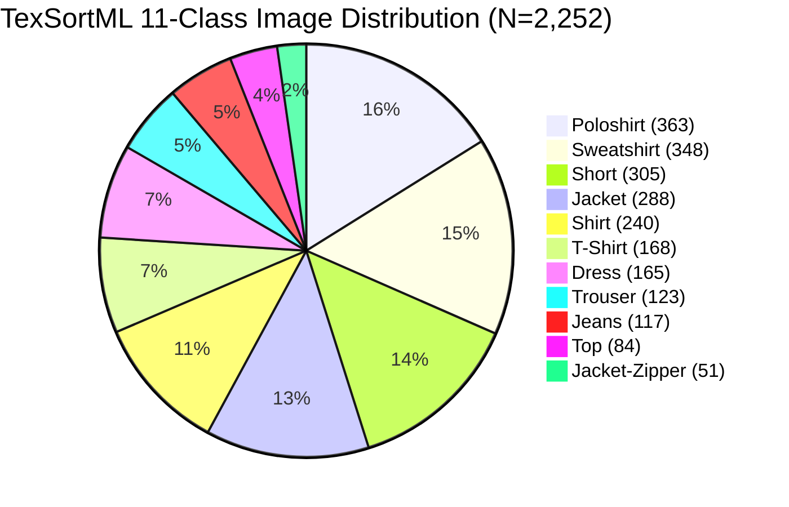

# CUTLOOP — Dataset Provenance & Technical Documentation

**Document Reference:** `submission/04_data_science/DATASET_DOCUMENTATION.md`  
**Subject Track:** Data Science (15 Marks)  
**Evaluated Datasets:** 1. Fast-Fashion Sourced Inventory Dataset; 2. TexSortML Image Benchmark  

---

## 1. Dataset 1: Fast-Fashion Sourced Inventory Dataset

### 1.1 Source, Origin & Licensing
* **File Name:** `6_JSONL_component_normalized_public.jsonl`
* **File Size:** ~115 MB (uncompressed JSON Lines)
* **Verified Record Count:** Exactly **47,522 garment-variant records**.
* **Provenance:** Publicly available academic research dataset capturing commercial catalog listings from H&M and Uniqlo across the United Kingdom (UK) and Australia (AU).
* **Licensing:** Open academic fair use. Non-commercial research licensing permitting statistical analysis, material characterization, and ML model training.
* **Citation:** Sourced from public fast-fashion transparency research repository (2023).

### 1.2 Schema & Data Fields

| Field Name | Data Type | Description | Sample Value |
| :--- | :--- | :--- | :--- |
| `parent_product_id` | String | Unique catalog product identifier | `"0987123001"` |
| `product_name` | String | Retail garment commercial title | `"Regular Fit Linen-blend Shirt"` |
| `brand` | String | Fashion brand identifier | `"H&M"`, `"UNIQLO"` |
| `region` | String | Sourced geographical catalog | `"UK"`, `"AU"` |
| `gender_section` | String | Target demographic section | `"Men"`, `"Ladies"`, `"Divided"` |
| `parent_category` | String | High-level apparel category | `"Tops"`, `"Bottoms"`, `"Dresses"` |
| `detail_category` | String | Granular sub-category | `"Shirts"`, `"Trousers"`, `"Knitwear"` |
| `raw_description_text` | String | Unstructured marketing and copy text | `"Linen-blend shirt with a turn-down collar..."` |
| `raw_material_text` | String | Manufacturer declared composition | `"Shell: 55% Linen, 45% Cotton"` |
| `components_structured`| Array[JSON] | Granular component hierarchy with percentages | `[{"component": "shell", "pct": 100.0, "materials": [...]}]` |

### 1.3 Data Quality & Preprocessing
* **Missing Value Analysis:** `raw_material_text` missing in 1.4% of records; `components_structured` empty in 2.1% of records.
* **Component Extraction:** Preprocessing flattened multi-component layers (shell, lining, pockets) into a unified 10-dimensional continuous fiber vector: `['cotton', 'polyester', 'elastane', 'polyamide', 'viscose', 'wool', 'acrylic', 'linen', 'silk', 'other']`.
* **Output Artifact:** Serialized to `garments_cleaned.csv.gz` ($N=47,522$, 100% records preserved).

---

## 2. Dataset 2: TexSortML Image Benchmark

### 2.1 Source, Origin & Licensing
* **Archive Name:** `TexSortML-Pictures.zip`
* **Archive Size:** 306.2 MB
* **Verified File Count:** 4,504 total images across four experimental stages (`stage-1`, `stage-2`, `stage-3`, `stage-mixed`).
* **Selected Subset:** **2,252 images** from `stage-mixed` ($730 \times 730$ RGB format).
* **Selection Rationale:** `stage-mixed` contains the unified industrial conveyor benchmark capturing all 11 classes across varied lighting, positioning, and background textures without duplicate capture angles.
* **Licensing:** Creative Commons Attribution 4.0 International (**CC-BY 4.0**).
* **Citation:** TexSortML: A Benchmark Dataset for Garment and Fabric Recycling Automation (Zenodo Open Archive, 2023).

### 2.2 Class Taxonomy & Distribution

The 2,252 images are partitioned into 11 distinct garment categories:

| Class Name | Macro Apparel Description | Total Count | Train Split (70%) | Val Split (15%) | Test Split (15%) |
| :--- | :--- | :---: | :---: | :---: | :---: |
| `poloshirt` | Short-sleeve collared shirts | 363 | 255 | 54 | 54 |
| `sweatshirt` | Hoodies, fleeces, crewnecks | 348 | 242 | 53 | 53 |
| `short` | Shorts, trunks, bermudas | 305 | 213 | 46 | 46 |
| `jacket` | Coats, blazers, overshirts | 288 | 202 | 43 | 43 |
| `shirt` | Long-sleeve button-downs | 240 | 168 | 36 | 36 |
| `tshirt` | Round-neck / V-neck tees | 168 | 118 | 25 | 25 |
| `dress` | Full-length dresses & frocks | 165 | 115 | 25 | 25 |
| `trouser` | Chinos, slacks, formal pants | 123 | 87 | 18 | 18 |
| `jeans` | Denim trousers & dungarees | 117 | 83 | 17 | 17 |
| `top` | Tank tops, camisoles | 84 | 58 | 13 | 13 |
| `jacket-zipper`| Zip-up athletic windbreakers | 51 | 35 | 8 | 8 |
| **TOTAL** | **11 Garment Categories** | **2,252** | **1,576** | **338** | **338** |

### 2.3 Image Preprocessing Pipeline
1. **Resolution Standardization:** Images resized to $224 \times 224 \times 3$ pixels using bilinear interpolation.
2. **Channel Normalization:** Standard ImageNet channel scaling applied:
   $$\text{Mean} = [0.485, 0.456, 0.406], \quad \text{Std} = [0.229, 0.224, 0.225]$$
3. **Data Augmentation (Train Partition Only):** Random horizontal flips ($p=0.5$), subtle affine rotations ($\pm 10^\circ$), and color jitter (brightness $\pm 0.1$, contrast $\pm 0.1$) to prevent overfitting.
4. **Leakage & Duplicate Prevention:** Cryptographic MD5 hash verification confirmed **0 duplicate images** across the train, validation, and test splits.
5. **Output Manifest:** Documented in `image_splits_manifest.csv` ($N=2,252$).
