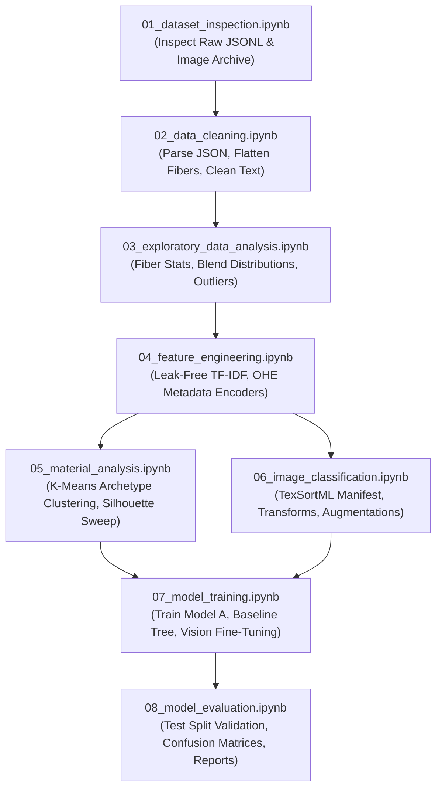

# CUTLOOP — Data Science Jupyter Notebook Index & Execution Protocol

**Document Reference:** `submission/04_data_science/DATA_SCIENCE_NOTEBOOK_INDEX.md`  
**Location:** `CUTLOOP/cutloop_ds/notebooks/`  
**Environment:** Python 3.10.x / Jupyter Notebook / Scikit-Learn / PyTorch  

---

## 1. Execution Pipeline Architecture

The CUTLOOP Data Science experimental pipeline is organized into eight sequential, reproducible Jupyter notebooks. Each notebook handles a self-contained stage of the machine learning lifecycle, producing serialized artifacts and report summaries.



---

## 2. Detailed Notebook Catalog

| Execution Order | Notebook File Name | Primary Purpose & Objectives | Key Inputs | Generated Output Artifacts |
| :---: | :--- | :--- | :--- | :--- |
| **Step 1** | `01_dataset_inspection.ipynb` | Audits raw fast-fashion JSONL (47,522 records) and TexSortML zip file (4,504 images). Analyzes missingness, file corruption, and schema hierarchy. | `6_JSONL...jsonl`, `TexSortML-Pictures.zip` | Data inspection logs, schema definition |
| **Step 2** | `02_data_cleaning.ipynb` | Extracts nested `components_structured` JSON, flattens multi-layer garments into 10 continuous fiber percentages, strips punctuation, normalizes text. | Raw JSONL dataset | `datasets/processed/garments_cleaned.csv.gz` ($N=47,522$) |
| **Step 3** | `03_exploratory_data_analysis.ipynb` | Performs descriptive statistical analysis on dominant fibers, brand distributions, mono-material ratios, and blend frequencies across categories. | `garments_cleaned.csv.gz` | Visualizations: `fiber_distribution.png`, `brand_breakdown.png` |
| **Step 4** | `04_feature_engineering.ipynb` | Constructs leak-free feature matrices: fits 400-dim TF-IDF on product text, one-hot encodes catalog metadata, stratifies 80/20 train/test splits. | `garments_cleaned.csv.gz` | `saved_models/feature_pipeline.joblib`, train/test sparse matrices |
| **Step 5** | `05_material_analysis.ipynb` | Performs unsupervised K-Means clustering in continuous 10D fiber space. Sweeps $k=2..8$ for elbow/silhouette analysis, discovering 5 recycling archetypes. | Continuous 10D fiber columns | `saved_models/model_c_kmeans.joblib`, `saved_models/archetype_profiles.json` |
| **Step 6** | `06_image_classification.ipynb` | Audits the 2,252 `stage-mixed` TexSortML images across 11 classes, verifies zero cross-split hash duplicates, builds PyTorch data loaders. | `TexSortML-Pictures.zip` | `datasets/processed/image_splits_manifest.csv` |
| **Step 7** | `07_model_training.ipynb` | Trains Model A (Balanced Random Forest) against Decision Tree baseline; trains MobileNetV2 transfer learning head with validation tracking. | Processed feature matrices, image splits | `saved_models/model_a_random_forest.joblib`, `saved_models/texsort_model.pt` |
| **Step 8** | `08_model_evaluation.ipynb` | Evaluates all models on held-out test splits: generates classification reports, precision/recall curves, confusion matrices, and audit logs. | Trained models, test split datasets | `visualizations/model_a_confusion_matrix.png`, `reports/08_model_evaluation_report.md` |

---

## 3. Recommended Sequential Execution Protocol

To execute all notebooks in an isolated, clean virtual environment:

```powershell
# 1. Activate CUTLOOP Python virtual environment
cd c:\Users\dhruv\OneDrive\Desktop\ds\CUTLOOP
& ".\cutloop-ai\venv\Scripts\Activate.ps1"

# 2. Launch Jupyter Lab / Notebook interface
jupyter notebook --notebook-dir="cutloop_ds/notebooks"

# 3. Alternatively, execute sequentially via headless nbconvert
$notebooks = @(
    "01_dataset_inspection.ipynb",
    "02_data_cleaning.ipynb",
    "03_exploratory_data_analysis.ipynb",
    "04_feature_engineering.ipynb",
    "05_material_analysis.ipynb",
    "06_image_classification.ipynb",
    "07_model_training.ipynb",
    "08_model_evaluation.ipynb"
)

foreach ($nb in $notebooks) {
    Write-Host "[*] Executing $nb..." -ForegroundColor Cyan
    jupyter nbconvert --to notebook --execute "cutloop_ds/notebooks/$nb" --inplace
}
```

*Note on Execution Time:* Running the entire 8-notebook sequence takes approximately **3 to 4 minutes** on standard 16 GB RAM CPU machines.
