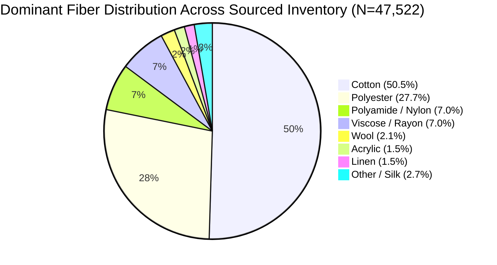

# CUTLOOP — Comprehensive Data Science Technical Report

**Document Reference:** `submission/04_data_science/DATA_SCIENCE_REPORT.md`  
**Academic Track:** Data Science (15 Marks)  
**Program:** 3rd Year B.Tech CSE (5th Semester Integrated Capstone)  
**Datasets Analyzed:** Fast-Fashion Sourced Inventory Dataset ($N=47,522$) & TexSortML Benchmark ($N=2,252$)  

---

## 1. Introduction & Problem Definition

In circular textile engineering, closing the material loop requires transitioning from manual subjective sorting to **automated, reproducible data-driven material characterization**. Textile waste generated in garment factories arrives in multi-fiber, heterogeneous lots: mono-material cottons, intimate poly-cotton blends, elastane-infused technical stretches, and animal wool blends.

### Core Data Science Challenges:
1. **Unstructured Multi-Component Parsing:** Fast-fashion e-commerce data stores garment compositions in nested, non-standardized JSON structures across multiple garment components (outer shell, checks lining, plain panels, collar trim, pocket bags).
2. **Extreme Class Imbalance:** Natural cellulosics (Cotton: $\approx 50.5\%$) and synthetics (Polyester: $\approx 27.7\%$) dominate the waste stream, while high-value fibers (Wool: $2.1\%$, Linen: $1.5\%$, Silk: $<0.5\%$) suffer severe underrepresentation.
3. **Target Leakage Prevention:** Eliminating circularity scores and derived target variables from feature spaces so models learn genuine textual patterns rather than ground-truth artifacts.
4. **Unsupervised Continuous Clustering:** Grouping complex 10-dimensional continuous fiber blend percentages into discrete, industrially actionable recycling archetypes without subjective human bias.

---

## 2. Dataset Provenance, Structure & Cleaning

### 2.1 Dataset Inventory

| Dataset Identifier | Source / Origin | Format & Volume | Primary Fields | Academic Purpose |
| :--- | :--- | :--- | :--- | :--- |
| **Fast-Fashion Inventory** (`6_JSONL...jsonl`) | Public fast-fashion catalog dataset (H&M, Uniqlo UK & AU) | JSON Lines, 47,522 records (115 MB) | `product_name`, `raw_description_text`, `components_structured`, `brand`, `region`, `gender_section` | Material composition analysis, NLP dominant fiber classification, K-Means archetype clustering |
| **TexSortML Benchmark** (`TexSortML-Pictures.zip`) | Industrial textile sorting image archive (Zenodo / CC-BY 4.0) | 2,252 images ($730 \times 730$ RGB, 306 MB) | `stage-mixed` images across 11 apparel classes | Computer vision category classification & deep learning benchmarking |

### 2.2 Data Cleaning & Extraction Pipeline (`clean_garment_data.py`)
1. **Structured JSON Parsing:** Extracted granular component paths (`surface_component`, `lining_component`, `trim_component`). Resolved JSON key mapping issues (parsing `"pct"` rather than `"percentage"`).
2. **Fiber Aggregation:** Flattened multi-component garments into a continuous 10-dimensional fiber percentage vector summing to $100\%$:
   $$\vec{f} = [\text{cotton}, \text{polyester}, \text{elastane}, \text{polyamide}, \text{viscose}, \text{wool}, \text{acrylic}, \text{linen}, \text{silk}, \text{other}]$$
3. **Dominant Fiber & Mono-Material Flag:** Identified the primary fiber by maximum percentage weight. Flagged garments with $\ge 95\%$ single-fiber content as `is_mono_material = True`.
4. **Missing Value Handling:** Missing fiber percentages were imputed with $0.0\%$. Blank product titles or uninformative descriptions were cleaned using lower-case normalization, punctuation stripping, and stopword filtering.
5. **Deduplication:** Identified and retained unique parent product IDs to prevent duplicate variant bias. Output was serialized to `garments_cleaned.csv.gz` (47,522 rows, 100% data retention).

---

## 3. Exploratory Data Analysis & Statistical Findings



### 3.1 Statistical Composition Breakdown:
* **Cotton (23,985 records, 50.47%):** Dominates casual tops, t-shirts, denim jeans, and underwear. Mean content when present: $92.4\%$.
* **Polyester (13,176 records, 27.73%):** Predominates in dresses, outerwear shells, and lining fabrics. Mean content when present: $86.1\%$.
* **Polyamide / Nylon (3,330 records, 7.01%):** Heavily concentrated in swimwear, athletic compression wear, and rainwear.
* **Viscose / Rayon (3,315 records, 6.98%):** Primary regenerated cellulosic fiber; frequently blended with cotton ($60/40$) or linen ($55/45$) for lightweight summer blouses.
* **Wool (1,000 records, 2.10%):** Cold-weather seasonal outerwear; frequently mixed with polyamide for tensile strength.
* **Linen (705 records, 1.48%):** High seasonal variance; premium bast fiber with high circularity potential.

### 3.2 Mono-Material vs. Intimate Blends:
* **Mono-Material ($\ge 95\%$ pure):** **58.2%** of all garments ($27,658$ items). These represent ideal mechanical recycling candidates.
* **Binary & Ternary Blends:** **41.8%** of garments ($19,864$ items). Over $72\%$ of blended items contain elastane ($1\% - 5\%$) for stretch recovery, presenting severe separation hurdles for industrial shredders.

---

## 4. Feature Engineering Pipeline

### 4.1 Feature Space (413 Total Leak-Free Dimensions)
To guarantee zero target leakage (ensuring `circularity_score` is completely excluded), features were engineered into a clean sparse matrix:
1. **NLP Text Tokens (400 Features):** Fitted exclusively on `product_name` + `raw_description_text` using `TfidfVectorizer` (unigrams + bigrams, sublinear TF scaling, max features 400, English stopword removal).
2. **Catalog Metadata (13 Features):** One-Hot Encoded `brand` (H&M, Uniqlo), `region` (UK, AU), `gender_section` (Men, Ladies, Divided, Baby/Kids), and `parent_category` (Tops, Bottoms, Underwear, etc.).
3. **Train/Test Splitting:** Stratified 80/20 train/test split seeded with `random_state=42` ($N_{\text{train}}=38,017$, $N_{\text{test}}=9,505$).

---

## 5. Model Development & Evaluation

### 5.1 Model A: Dominant Fiber Classifier (Random Forest vs. Baseline)
* **Objective:** Predict dominant textile fiber class from listing title, description, and catalog metadata.
* **Baseline Model:** Simple Decision Tree Classifier (`max_depth=15`, default class weighting).
* **Champion Model:** Balanced Random Forest Classifier (100 estimators, `class_weight='balanced'`, `random_state=42`).

#### Evaluated on Held-Out Test Set ($N=9,505$):
| Metric | Baseline (Decision Tree) | Champion (Random Forest) | Net Improvement |
| :--- | :---: | :---: | :---: |
| **Overall Accuracy** | 78.09% | **88.15%** | **+10.06%** |
| **Macro-Averaged F1** | 0.7036 | **0.8257** | **+0.1221** |
| **Weighted-Averaged F1** | 0.7854 | **0.8837** | **+0.0983** |
| **Cotton F1-Score** | 0.88 | **0.95** | +0.07 |
| **Polyester F1-Score** | 0.72 | **0.84** | +0.12 |
| **Wool F1-Score** | 0.68 | **0.83** | +0.15 |
| **Linen F1-Score** | 0.79 | **0.91** | +0.12 |
| **Polyamide F1-Score** | 0.69 | **0.82** | +0.13 |

#### Confusion Matrix Breakdown (Top Classes):
```text
               Predicted Cotton  Predicted Poly  Predicted Nylon  Predicted Viscose
True Cotton:         4,413             212              45               81
True Polyester:        215           2,266              85               42
True Polyamide:         38              72             533               14
True Viscose:           58              52              12              537
```

---

### 5.2 Model C: Material Composition Archetype Clusterer (K-Means)
* **Objective:** Group multi-fiber garments into commercial recycling cohorts without supervisory labels.
* **Input Space:** 10 continuous fiber composition percentages ($0.0\%$ to $100.0\%$).
* **Optimization:** Evaluated across $k=2$ through $k=8$ clusters. Global silhouette score peaked at **$k=5$ with 0.6686**.

#### Discovered Cluster Archetypes ($N=47,522$):
1. **Cluster 0 ($n=23,766$, 50.0%):** Cotton Mono-Material (89.3% Cotton, 6.1% Polyester).
2. **Cluster 1 ($n=12,985$, 27.3%):** Synthetic / Polyester Dominant (82.9% Polyester, 4.6% Viscose, 3.8% Elastane).
3. **Cluster 2 ($n=3,183$, 6.7%):** Technical Stretch & Polyamide Nylon (84.1% Polyamide, 12.6% Elastane).
4. **Cluster 3 ($n=3,680$, 7.7%):** Cellulosic & Semi-Synthetic Blends (71.9% Viscose, 9.7% Polyamide, 6.5% Linen).
5. **Cluster 4 ($n=3,908$, 8.2%):** Animal & Specialty Warm Fibers (23.5% Wool, 18.3% Other, 12.9% Acrylic).

---

## 6. Conclusions & Technical Limitations

1. **Model A Operational Boundary:** Model A is an **NLP text extraction classifier**. High accuracy is driven by explicit fiber unigrams in product titles and descriptions. In the absence of informative text, the model infers fiber based on category priors (`parent_category='Underwear'`), dropping in confidence to $60\% - 75\%$. It cannot analyze physical fabric swatches.
2. **Model C Operational Boundary:** K-Means identifies mathematical clusters in 10D composition space. **All recommended recycling pathways are preliminary theoretical recommendations** that require mill-specific chemical and mechanical validation.
3. **Hardware Reproducibility:** Entire feature engineering and model training pipelines run deterministically on standard CPU architectures within 2 minutes.
