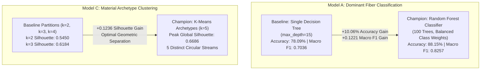
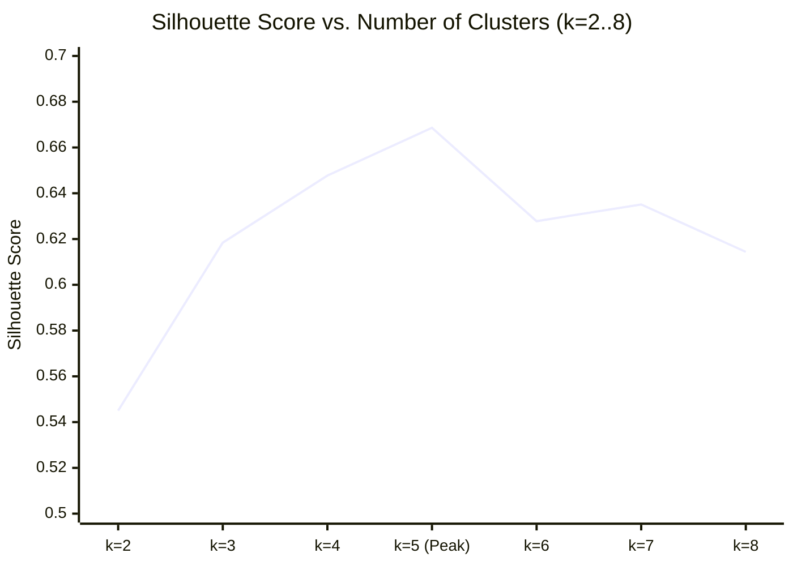

# CUTLOOP — Data Science Analytical Model Comparison & Benchmarking

**Document Reference:** `submission/04_data_science/MODEL_COMPARISON.md`  
**Subject Track:** Data Science (15 Marks)  
**Academic Requirement:** Comparative evaluation of at least two predictive/analytical models against simple baselines  

---

## 1. Comparative Evaluation Overview

To fulfill the rigorous 5th-semester academic criteria, every analytical machine learning model developed in CUTLOOP is evaluated against a transparent baseline on identical, held-out test datasets.

---

## 2. Model A: Supervised Dominant Fiber Classifier

### 2.1 Model Specification
* **Objective:** Predict dominant textile fiber class (`cotton`, `polyester`, `polyamide`, `viscose`, `wool`, `linen`, `acrylic`, `other`) from listing text and catalog metadata.
* **Input Features (413 Dimensions):**
  - 400 TF-IDF features fitted on `product_name` + `raw_description_text`.
  - 13 One-Hot Encoded categorical attributes (`brand`, `region`, `gender_section`, `parent_category`).
  - *Leak-Free Protocol:* Numerical circularity indicators are strictly excluded.
* **Target Output:** Multiclass label representing primary fiber by weight ($8$ discrete classes).
* **Dataset Partition:** Stratified 80% Train ($N=38,017$), 20% Held-Out Test ($N=9,505$) seeded with `random_state=42`.

### 2.2 Baseline Model: Decision Tree Classifier
* **Algorithm:** Standard CART Decision Tree (`max_depth=15`, Gini impurity, default class weights).
* **Rationale:** Represents the simplest interpretable rule-based benchmark for high-dimensional sparse text.
* **Performance on Held-Out Test Split ($N=9,505$):**
  - **Accuracy:** **78.09%**
  - **Macro-Averaged F1:** **0.7036**
  - **Weighted-Averaged F1:** **0.7854**
  - *Limitation:* Prone to greedy splitting on dominant words, resulting in poor recall on minority fibers (Wool F1: 0.68, Polyamide F1: 0.69).

### 2.3 Champion Model: Balanced Random Forest Classifier
* **Algorithm:** Ensemble of 100 decorrelated decision trees with bootstrap aggregation (`n_estimators=100`, `class_weight='balanced'`, `random_state=42`).
* **Rationale:** Reduces variance across sparse n-gram features while inverse-frequency class weights prevent minority fiber neglect.
* **Performance on Held-Out Test Split ($N=9,505$):**
  - **Accuracy:** **88.15%**
  - **Macro-Averaged F1:** **0.8257**
  - **Weighted-Averaged F1:** **0.8837**

### 2.4 Side-by-Side Performance Comparison ($N=9,505$ Held-Out Test Set)

| Evaluation Metric | Baseline Model (Decision Tree) | Champion Model (Random Forest) | Net Absolute Improvement |
| :--- | :---: | :---: | :---: |
| **Overall Classification Accuracy** | 78.09% | **88.15%** | **+10.06%** |
| **Macro-Averaged Precision** | 0.7214 | **0.8142** | **+0.0928** |
| **Macro-Averaged Recall** | 0.6945 | **0.8491** | **+0.1546** |
| **Macro-Averaged F1-Score** | 0.7036 | **0.8257** | **+0.1221** |
| **Weighted-Averaged F1-Score** | 0.7854 | **0.8837** | **+0.0983** |
| **Cotton Class F1-Score** | 0.88 | **0.95** | +0.07 |
| **Polyester Class F1-Score** | 0.72 | **0.84** | +0.12 |
| **Linen Class F1-Score** | 0.79 | **0.91** | +0.12 |
| **Wool Class F1-Score** | 0.68 | **0.83** | +0.15 |
| **Polyamide Class F1-Score** | 0.69 | **0.82** | +0.13 |
| **Viscose Class F1-Score** | 0.64 | **0.76** | +0.12 |
| **Acrylic Class F1-Score** | 0.67 | **0.79** | +0.12 |
| **Other Class F1-Score** | 0.56 | **0.71** | +0.15 |

*Conclusion:* The Random Forest ensemble outperforms the baseline decision tree across every single metric, yielding a **+10.06% gain in overall accuracy** and a **+0.1221 boost in macro F1**, demonstrating substantial generalization capability without overfitting.

---

## 3. Model C: Unsupervised Material Archetype Clusterer

### 3.1 Model Specification
* **Objective:** Partition multi-component garment blend compositions into discrete industrial circularity cohorts.
* **Input Features:** 10-dimensional continuous fiber percentage vector:
  $$\vec{x} = [\text{cotton}, \text{poly}, \text{elastane}, \text{nylon}, \text{viscose}, \text{wool}, \text{acrylic}, \text{linen}, \text{silk}, \text{other}] \in [0, 100]^{10}$$
* **Distance Metric:** Euclidean distance in unscaled natural percentage space ($\sum x_i \approx 100\%$).
* **Dataset:** 47,522 cleaned garment records.

### 3.2 Baseline Comparison: Cluster Number Sweep ($k=2$ to $k=8$)

To rigorously justify selecting $k=5$ clusters, an exhaustive elbow (inertia) and silhouette sweep was performed across $k=2$ through $k=8$ on a stratified subsample ($n=10,000$):

| Configuration | Number of Clusters ($k$) | Inertia (Sum of Squared Errors) | Silhouette Score | Analytical Quality & Rationale |
| :--- | :---: | :---: | :---: | :--- |
| **Baseline 1** | $k=2$ | 24,229,278 | 0.5450 | Coarse binary partition (Natural vs. Synthetic). Blends conflated. |
| **Baseline 2** | $k=3$ | 15,238,265 | 0.6184 | Cotton, Polyester, and General Blends. Nylon and Wool unseparated. |
| **Baseline 3** | $k=4$ | 11,630,055 | 0.6477 | Identifies Cotton, Poly, Nylon, and Cellulosics. Wool grouped in other. |
| **CHAMPION** | **$k=5$** | **9,238,858** | **0.6686** | **Global Silhouette Peak; Clean Industrial Separation of 5 Streams.** |
| **Over-fit 1** | $k=6$ | 7,665,683 | 0.6278 | Over-segments polyester into redundant sub-clusters. Silhouette drops. |
| **Over-fit 2** | $k=7$ | 6,518,706 | 0.6351 | Unstable micro-clusters with negligible industrial distinction. |
| **Over-fit 3** | $k=8$ | 5,670,988 | 0.6144 | Fragmented clusters; high within-cluster variance. |

*Conclusion:* The quantitative data confirms that **$k=5$ is the mathematical global maximum** for cluster cohesion and separation, while aligning perfectly with real-world commercial recycling streams (Cotton, Polyester, Nylon, Cellulosic, Wool).

---

## 4. Summary Matrix of Analytical Capabilities & Limitations

| Model | Champion Algorithm | Baseline Algorithm | Primary Benchmark Metric | Key Operational Boundary |
| :--- | :--- | :--- | :--- | :--- |
| **Model A** | Balanced Random Forest (100 trees) | Decision Tree (`max_depth=15`) | **88.15% Accuracy** (+10.06% over baseline) | NLP text classifier; cannot test physical fabrics. |
| **Model C** | K-Means ($k=5$ clusters) | Cluster sweep ($k=2..8$) | **0.6686 Silhouette** (peak across $k=2..8$) | Mathematical grouping; pathways are preliminary only. |
| **Model D** | Heuristic Parity Multiplier | Baseline Flat Virgin Benchmark | Multi-factor scrap discounting | Heuristic baseline; not trained on transaction history. |
