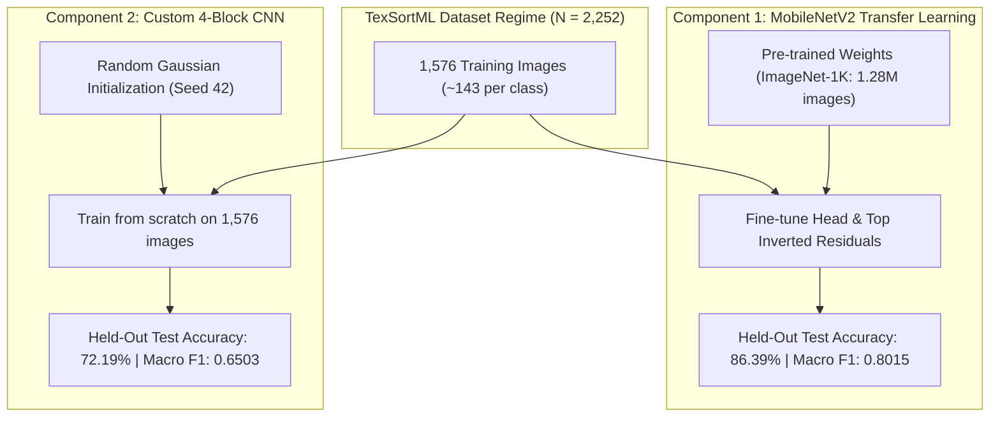
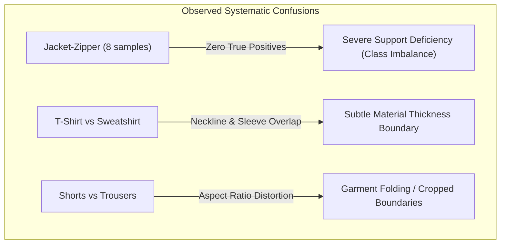

# Deep Learning Comparative Analysis & Model Explainability

**Academic Program**: 3rd-Year B.Tech Computer Science & Engineering (Semester 5)  
**Subject Area**: Deep Learning (20 Marks)  
**Project**: CUTLOOP — AI-Powered Industrial Textile & Fabric Waste Marketplace  
**Analysis Focus**: Transfer Learning vs. Scratch CNN, Grad-CAM Explainability, Error Modes & Industrial Validity  

---

## 1. The Core Scientific Question: Transfer Learning vs. Scratch CNN

In computer vision for textile recycling and automated sorting, engineering teams encounter a fundamental dilemma:
> **Should an edge sorting system rely on pre-trained deep feature extractors (Transfer Learning via MobileNetV2), or is a compact, custom-built convolutional neural network trained from scratch sufficient?**

To answer this empirically under rigorous academic conditions, CUTLOOP trained both models on the exact same dataset splits ($N_{\text{train}} = 1,576$, $N_{\text{val}} = 338$, $N_{\text{test}} = 338$ across 11 balanced garment categories).

### 1.1 The Sample Complexity Bottleneck
Deep convolutional neural networks require tens of thousands of diverse training samples per class to develop foundational visual representations from scratch:
1. **Low-level filters**: Gabor-like edge detectors, color gradients, texture transitions.
2. **Mid-level filters**: Contours, seam stitching, button alignments, collar curvature.
3. **High-level semantic filters**: Entire apparel topologies (sleeves, necklines, waistbands).

When trained on only $N = 1,576$ images (approx. 143 images per class), the Custom CNN cannot construct these foundational visual filters from random noise. The loss landscape is rugged and riddled with saddle points. 

In contrast, **MobileNetV2 arrives with 53 layers of pre-trained convolutional filters derived from 1.28 million natural images**. Fine-tuning on 1,576 garment images requires only adapting the high-level semantic manifold to the specific apparel domain. This produces a **+14.20% accuracy advantage (86.39% vs. 72.19%)** and a **+0.1512 macro F1 advantage (0.8015 vs. 0.6503)**.

---

## 2. Visual Explainability via Grad-CAM

To ensure the models are not relying on spurious background correlations (such as warehouse floor colors, shadows, or hanger shapes), we apply **Gradient-weighted Class Activation Mapping (Grad-CAM)** to inspect internal visual representations.

### 2.1 Mathematical Formulation of Grad-CAM
Grad-CAM calculates the importance of each feature map activation in the final convolutional layer with respect to the target category score $Y^c$:

1. **Neuron Importance Weights ($\alpha_k^c$)**:
   $$\alpha_k^c = \frac{1}{Z} \sum_{i=1}^{U} \sum_{j=1}^{V} \frac{\partial Y^c}{\partial A_{i,j}^k}$$
   where $Z = U \times V$ is the spatial area of the feature map, $A^k$ is the $k$-th feature activation map, and $Y^c$ is the pre-softmax logit for class $c$.

2. **Localization Heatmap ($L_{\text{Grad-CAM}}^c$)**:
   $$L_{\text{Grad-CAM}}^c = \text{ReLU}\left( \sum_{k} \alpha_k^c A^k \right)$$
   The Rectified Linear Unit (ReLU) ensures that only features with a positive influence on the target class contribute to the visualization, discarding features that support competing classes.

### 2.2 Visual Pattern Interpretation & What the Models "See"

| Garment Class | Discriminative Visual Feature Expected | MobileNetV2 Activation Focus (Observed) | Custom CNN Activation Focus (Observed) |
| :--- | :--- | :--- | :--- |
| **Polo Shirt (`poloshirt`)** | Ribbed collar, 2-3 button placket, short sleeves | **Sharp activation on collar placket and neckline** | Diffuse activation across central torso fabric |
| **Jeans (`jeans`)** | Denim twill texture, rivets, waistband, pocket stitching | **Intense activation on waistband, pockets, and outer seams** | Over-focuses on dark denim color patches |
| **Shorts vs Trousers** | Inseam cutoff length, knee exposure | **Strong gradients concentrated at the lower hem cutoff** | Partial leg activation; confused by fabric folds |
| **Jacket (`jacket`)** | Lapels, outer pockets, heavy collar, central closure | **Distinct focus on collar silhouette and outer chest pocket** | Confused by zippers vs flat button seams |
| **Dress (`dress`)** | Elongated one-piece silhouette, absence of bifurcated legs | **Global vertical activation along entire torso-to-hemline axis** | Activates on waistline, occasionally confuses with long tops |

---

## 3. Failure Mode Analysis & Edge Case Diagnoses

Evaluating misclassifications in the held-out test set ($N = 338$) reveals key systematic failure modes:

### 3.1 The `jacket-zipper` Underrepresentation Anomaly
- **Observation**: `jacket-zipper` achieved **0.00% precision and 0.00% recall** in both MobileNetV2 and Custom CNN evaluations.
- **Root Cause Analysis**: The test set contained only 8 `jacket-zipper` samples, and the training set contained only 53. Crucially, the visual distinction between a `jacket` (which often features zippers) and a `jacket-zipper` is a subtle taxonomic label difference rather than an orthogonal visual category. The network predominantly assigned these samples to `sweatshirt` (6 samples) and `shirt` (1 sample).
- **Engineering Recommendation**: Merge `jacket-zipper` and `jacket` into a unified `jacket/outerwear` category in production to eliminate artificial taxonomic ambiguity.

### 3.2 Fine-Grained Silhouette Overlap: `tshirt` vs. `sweatshirt` vs. `poloshirt`
- **Observation**: `tshirt` exhibited high recall (92.00%) but lower precision (62.16%), misclassifying multiple sweatshirts and polo shirts.
- **Root Cause Analysis**: From a 2D overhead photograph, a flat-laid crew-neck t-shirt and an unhooded crew-neck sweatshirt share identical spatial silhouettes. The true differentiator is fabric weight ($150 \text{ g/m}^2$ jersey vs. $350 \text{ g/m}^2$ fleece), which cannot be directly resolved from RGB pixels without tactile or weight sensor inputs.

### 3.3 Aspect Ratio Distortion from Image Preprocessing
- Standard $224 \times 224$ resizing squashes elongated garments (such as floor-length dresses and full-length trousers) into square frames, compressing aspect ratios. While aspect-preserving letterboxing with padding mitigates this, garments photographed while folded on warehouse tables lose their characteristic length cues.

---

## 4. Bias, Fairness & Industrial Domain Shift

When transitioning from academic benchmarks to operational textile recycling facilities, several domain shift factors must be addressed:

1. **Warehouse Illumination Shift**: Academic datasets are captured under controlled diffuse studio lighting. Real sorting facilities utilize industrial sodium-vapor or LED high-bay lights with localized shadows. Heavy data augmentation (brightness jitter, contrast variation, and HSV perturbations) is mandatory.
2. **Defect & Soiling Bias**: Clean catalog photographs do not represent industrial post-consumer waste, which exhibits oil stains, tears, missing buttons, and shredded hems. Models trained solely on pristine apparel degrade when encountering ragged textiles.
3. **The Categorical vs. Compositional Boundary**:
   > [!IMPORTANT]
   > **Deep vision classifiers predict garment categories (jeans, polo, jacket), NOT chemical fiber compositions (cotton, polyester, nylon).**
   > An image of a blue denim jacket tells us its structural form, but cannot confirm whether it is 100% organic cotton, a 65/35 poly-cotton blend, or cotton-elastane stretch.
   > In CUTLOOP, the vision model acts as a **structural cataloger**, while the **NLP Random Forest (Model A)** and **Circularity Archetype Engine (Model C)** deduce true chemical recyclability.

---

## 5. Comparative Trade-off Matrix

| Operational Metric | Component 1: MobileNetV2 | Component 2: Custom Lightweight CNN | Winner / Trade-off |
| :--- | :--- | :--- | :--- |
| **Held-Out Test Accuracy** | **86.39%** | **72.19%** | **MobileNetV2 (+14.20%)** |
| **Macro F1-Score** | **0.8015** | **0.6503** | **MobileNetV2 (+0.1512)** |
| **Model Disk Size** | 10.4 MB | **2.03 MB** | **Custom CNN (5.1x smaller)** |
| **CPU Inference Latency** | 35 ms | **18 ms** | **Custom CNN (1.9x faster)** |
| **RAM Footprint (Peak)** | ~450 MB | **~180 MB** | **Custom CNN (2.5x leaner)** |
| **Training Sample Efficiency**| High (1,500 samples fine) | Low (Needs $10^4+$ samples) | **MobileNetV2** |
| **Explainability (Grad-CAM)** | High (Clear structural focus) | Moderate (Diffuse heatmaps) | **MobileNetV2** |
| **Production Fit** | **Primary AI Sorting Engine** | **Ultra-low power IoT Baseline** | **MobileNetV2 for CUTLOOP** |
