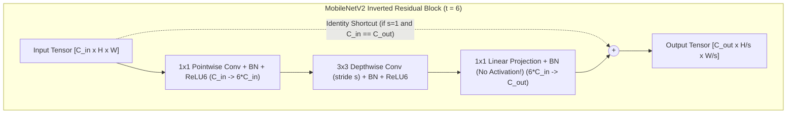
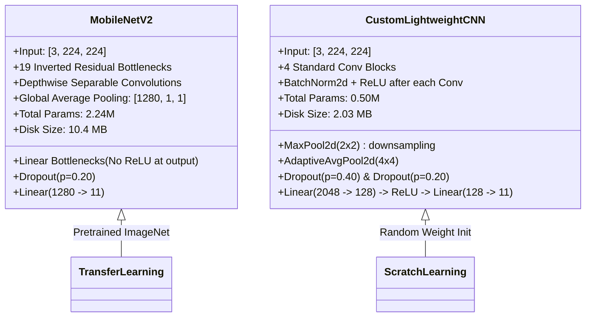

# Deep Learning Model Architectures — Technical Specification

**Project**: CUTLOOP — AI-Powered Industrial Textile & Fabric Waste Marketplace  
**Document**: Architectural Design & Topology Comparison of Deep Vision Classifiers  
**Target Category Count**: 11 Garment Categories  

---

## 1. Architectural Philosophy & Design Principles

Industrial textile sorting requires computer vision models that balance **classification accuracy**, **inference latency on commodity edge hardware**, and **parameter efficiency**. In warehouse environments, edge servers or sorting conveyor cameras often lack high-end enterprise GPUs; models must execute in real time on multi-core CPUs.

CUTLOOP evaluates two distinct paradigms:
1. **Component 1 (MobileNetV2)**: State-of-the-art inverted residual bottlenecks using depthwise separable convolutions pre-trained on ImageNet.
2. **Component 2 (Custom Lightweight CNN)**: A classical hierarchical convolutional architecture designed from first principles with batch normalization, spatial pooling, and dropout regularization.

---

## 2. Component 1: MobileNetV2 Inverted Residual Network

### 2.1 Depthwise Separable Convolutions
Standard 2D convolutions jointly filter and combine visual features in a single step, resulting in high computational complexity ($D_K \cdot D_K \cdot M \cdot N \cdot D_F \cdot D_F$). MobileNetV2 replaces this with **Depthwise Separable Convolutions**, factoring the operation into two distinct layers:
1. **Depthwise Convolution**: Applies a single $3 \times 3$ convolutional filter per input channel to extract spatial features independently.
2. **Pointwise Convolution**: Applies a $1 \times 1$ convolution across all channels to compute linear combinations of the depthwise features.

Computational cost reduction:
$$\frac{D_K \cdot D_K \cdot M \cdot D_F \cdot D_F + M \cdot N \cdot D_F \cdot D_F}{D_K \cdot D_K \cdot M \cdot N \cdot D_F \cdot D_F} = \frac{1}{N} + \frac{1}{D_K^2} \approx \frac{1}{9}$$
This yields an **8- to 9-fold reduction in Multiply-Accumulate (MAC) operations** with minimal loss in classification capacity.

### 2.2 Inverted Residuals & Linear Bottlenecks
Standard residual networks (e.g., ResNet) use bottleneck blocks that compress channels ($d \rightarrow d/4 \rightarrow d$) and use non-linear activations throughout. MobileNetV2 inverts this principle:
- **Expansion ($1 \times 1$ Conv)**: Expands input channels by an expansion factor $t = 6$ into a higher-dimensional manifold where non-linear ReLU6 can operate without destroying information.
- **Depthwise Filtering ($3 \times 3$ Conv)**: Extracts spatial patterns in the expanded space.
- **Projection ($1 \times 1$ Linear Bottleneck)**: Projects features back to a low-dimensional manifold **without a non-linear activation**. Removing non-linearity in the narrow bottleneck prevents ReLU from zeroing out valuable manifold representations.
- **Residual Shortcut**: When stride $= 1$ and input channels equal output channels, an identity shortcut connects the input directly to the output.

### 2.3 Complete MobileNetV2 Layer Specification

| Stage | Input Dimensions | Operator / Layer | Expansion ($t$) | Output Channels ($c$) | Repetitions ($n$) | Stride ($s$) |
| :--- | :--- | :--- | :--- | :--- | :--- | :--- |
| **Input** | $3 \times 224 \times 224$ | Standard Conv2d $3 \times 3$ | - | 32 | 1 | 2 |
| **Bottleneck 1** | $32 \times 112 \times 112$ | Inverted Residual | 1 | 16 | 1 | 1 |
| **Bottleneck 2** | $16 \times 112 \times 112$ | Inverted Residual | 6 | 24 | 2 | 2 |
| **Bottleneck 3** | $24 \times 56 \times 56$ | Inverted Residual | 6 | 32 | 3 | 2 |
| **Bottleneck 4** | $32 \times 28 \times 28$ | Inverted Residual | 6 | 64 | 4 | 2 |
| **Bottleneck 5** | $64 \times 14 \times 14$ | Inverted Residual | 6 | 96 | 3 | 1 |
| **Bottleneck 6** | $96 \times 14 \times 14$ | Inverted Residual | 6 | 160 | 3 | 2 |
| **Bottleneck 7** | $160 \times 7 \times 7$ | Inverted Residual | 6 | 320 | 1 | 1 |
| **Feature Head** | $320 \times 7 \times 7$ | Conv2d $1 \times 1$ + BN + ReLU6 | - | 1280 | 1 | 1 |
| **Pooling** | $1280 \times 7 \times 7$ | AdaptiveAvgPool2d($1 \times 1$) | - | 1280 | 1 | - |
| **Classifier**| $1 \times 1280$ | Dropout ($p=0.2$) $\rightarrow$ Linear | - | **11** | 1 | - |

**Total Parameters**: 2,238,027 (~2.24M) | **Model File**: `cutloop_ds/saved_models/texsort_model.pt` (10.4 MB).

---

## 3. Component 2: Custom Lightweight 4-Block CNN

### 3.1 Design Principles for Data-Constrained Regimes
When designing a neural network to be trained strictly from scratch on small datasets ($N \approx 1,500$), overparameterization must be avoided. A massive model (such as ResNet-50 with 25M parameters) would rapidly memorize training samples, resulting in catastrophic overfitting.

The CUTLOOP Custom CNN follows three fundamental regularization and efficiency principles:
1. **Compact Channel Hierarchy**: Increases channels gradually ($3 \rightarrow 32 \rightarrow 64 \rightarrow 128 \rightarrow 128$) to limit parameter growth.
2. **Pervasive Batch Normalization**: Normalizes mini-batch activations ($\mu=0, \sigma^2=1$) before each non-linearity, smoothing the loss landscape and stabilizing gradient propagation.
3. **Multi-Stage Dropout Regularization**: Employs $40\%$ dropout after flattening and $20\%$ dropout in the hidden dense layer to prevent co-adaptation of neurons.

```mermaid
flowchart TD
    subgraph Custom_CNN["Custom Lightweight 4-Block CNN"]
        I["Input: 3 x 224 x 224 RGB"] --> B1["Block 1: Conv(3->32, 3x3) + BN + ReLU + MaxPool(2x2) -> 32 x 112 x 112"]
        B1 --> B2["Block 2: Conv(32->64, 3x3) + BN + ReLU + MaxPool(2x2) -> 64 x 56 x 56"]
        B2 --> B3["Block 3: Conv(64->128, 3x3) + BN + ReLU + MaxPool(2x2) -> 128 x 28 x 28"]
        B3 --> B4["Block 4: Conv(128->128, 3x3) + BN + ReLU + AdaptiveAvgPool(4x4) -> 128 x 4 x 4"]
        B4 --> FL["Flatten (2,048 dimensions)"]
        FL --> DO1["Dropout (p = 0.40)"]
        DO1 --> FC1["Linear(2048 -> 128) + ReLU"]
        FC1 --> DO2["Dropout (p = 0.20)"]
        DO2 --> FC2["Linear(128 -> 11 Categories)"]
        FC2 --> SM["Logits / Softmax Output"]
    end
```

### 3.2 Exact Parameter Count & Tensor Shape Tracing

| Layer / Sub-block | Component Operation | Output Tensor Shape | Trainable Weights ($W$) | Biases ($b$) | Total Layer Parameters |
| :--- | :--- | :--- | :--- | :--- | :--- |
| **Input Image** | Raw Normalized RGB | `[B, 3, 224, 224]` | - | - | 0 |
| **Block 1: Conv** | `Conv2d(3, 32, k=3, p=1)` | `[B, 32, 224, 224]` | $3 \times 3 \times 3 \times 32 = 864$ | 32 | 896 |
| **Block 1: BN** | `BatchNorm2d(32)` | `[B, 32, 224, 224]` | $\gamma: 32$ | $\beta: 32$ | 64 |
| **Block 1: Pool** | `MaxPool2d(2, 2)` | `[B, 32, 112, 112]` | - | - | 0 |
| **Block 2: Conv** | `Conv2d(32, 64, k=3, p=1)`| `[B, 64, 112, 112]` | $3 \times 3 \times 32 \times 64 = 18,432$ | 64 | 18,496 |
| **Block 2: BN** | `BatchNorm2d(64)` | `[B, 64, 112, 112]` | $\gamma: 64$ | $\beta: 64$ | 128 |
| **Block 2: Pool** | `MaxPool2d(2, 2)` | `[B, 64, 56, 56]` | - | - | 0 |
| **Block 3: Conv** | `Conv2d(64, 128, k=3, p=1)`| `[B, 128, 56, 56]` | $3 \times 3 \times 64 \times 128 = 73,728$ | 128 | 73,856 |
| **Block 3: BN** | `BatchNorm2d(128)` | `[B, 128, 56, 56]` | $\gamma: 128$ | $\beta: 128$ | 256 |
| **Block 3: Pool** | `MaxPool2d(2, 2)` | `[B, 128, 28, 28]` | - | - | 0 |
| **Block 4: Conv** | `Conv2d(128, 128, k=3, p=1)`|`[B, 128, 28, 28]` | $3 \times 3 \times 128 \times 128 = 147,456$| 128 | 147,584 |
| **Block 4: BN** | `BatchNorm2d(128)` | `[B, 128, 28, 28]` | $\gamma: 128$ | $\beta: 128$ | 256 |
| **Block 4: Pool** | `AdaptiveAvgPool2d((4, 4))`| `[B, 128, 4, 4]` | - | - | 0 |
| **Classifier: Flat**| `Flatten()` | `[B, 2048]` | - | - | 0 |
| **Classifier: DO1** | `Dropout(p=0.40)` | `[B, 2048]` | - | - | 0 |
| **Classifier: FC1** | `Linear(2048, 128)` | `[B, 128]` | $2048 \times 128 = 262,144$ | 128 | 262,272 |
| **Classifier: DO2** | `Dropout(p=0.20)` | `[B, 128]` | - | - | 0 |
| **Classifier: FC2** | `Linear(128, 11)` | `[B, 11]` | $128 \times 11 = 1,408$ | 11 | 1,419 |
| **Total Model** | - | - | - | - | **505,227 Parameters** |

**Model File on Disk**: `cutloop_ds/saved_models/custom_cnn_model.pt` (2.03 MB).

---

## 4. Receptive Field & Spatial Feature Analysis

Understanding the receptive field of each layer confirms how visual patterns (edges $\rightarrow$ collars $\rightarrow$ entire silhouettes) are synthesized:

$$\text{RF}_{l} = \text{RF}_{l-1} + (k_l - 1) \cdot \prod_{i=1}^{l-1} s_i$$

1. **Block 1**: Kernel $3 \times 3$, Stride 1. $\text{RF} = 3 \times 3$ pixels. Extracts microscopic textile textures, yarn weave granularity, and high-frequency edge gradients.
2. **Post-Pool 1**: Effective stride $= 2$.
3. **Block 2**: Kernel $3 \times 3$, Stride 1. $\text{RF} = 3 + (3-1) \cdot 2 = 7 \times 7$ pixels. Captures seams, buttonhole stitching, and zipper teeth contours.
4. **Post-Pool 2**: Effective stride $= 4$.
5. **Block 3**: Kernel $3 \times 3$, Stride 1. $\text{RF} = 7 + (3-1) \cdot 4 = 15 \times 15$ pixels. Captures mid-level garment structures: polo collars, sleeve cuffs, and waistband transitions.
6. **Post-Pool 3**: Effective stride $= 8$.
7. **Block 4**: Kernel $3 \times 3$, Stride 1. $\text{RF} = 15 + (3-1) \cdot 8 = 31 \times 31$ pixels.
8. **Adaptive Average Pooling ($4 \times 4$)**: Pools the $31 \times 31$ receptive field regions across the entire $224 \times 224$ image frame, synthesizing global apparel silhouette topology (e.g., distinguishing the elongated profile of a dress from the bifurcated structure of shorts or trousers).

---

## 5. Comparative Architectural Topology Summary

