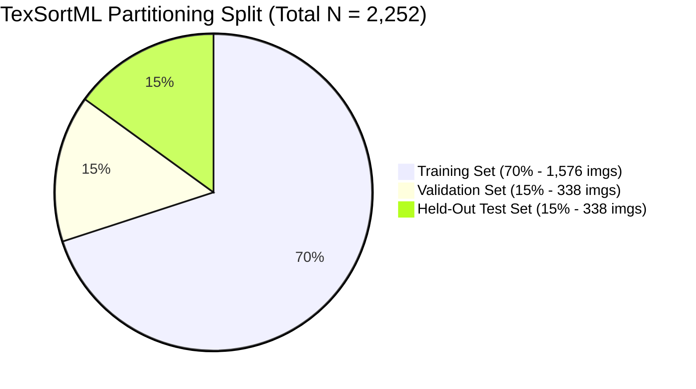
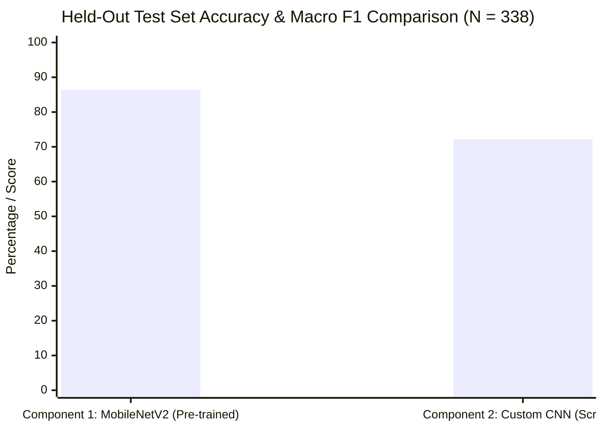

# Deep Learning Model Summary — CUTLOOP Vision Intelligence

**Academic Program**: 3rd-Year B.Tech Computer Science & Engineering (Semester 5)  
**Subject Area**: Deep Learning (20 Marks)  
**Project**: CUTLOOP — AI-Powered Industrial Textile & Fabric Waste Marketplace  
**Vision Task**: Multi-class Garment Category Visual Classification (11 Categories)  
**Dataset Benchmark**: TexSortML Industrial Garment Image Archive ($N = 2,252$ images, 11 balanced classes)  

---

## 1. Executive Summary & Objective

In textile circularity and industrial waste sorting, visual classification of discarded garments is the foundational first step before mechanical shredding, chemical fiber extraction, or secondary marketplace resale. Textile sorting facilities process high volumes of mixed apparel where manual visual inspection is slow, error-prone, and cost-prohibitive.

The CUTLOOP Deep Learning module implements and contrasts **two complete, functional deep convolutional neural network architectures** to automate this visual inspection:

1. **Component 1 (Primary Production Model)**: **MobileNetV2 Transfer Learning Classifier**  
   Pre-trained on ImageNet-1K features and fine-tuned on the TexSortML industrial apparel sorting benchmark. Designed for edge deployment, high accuracy, and low inference latency in industrial facilities.
2. **Component 2 (From-Scratch Baseline Model)**: **Custom Lightweight 4-Block CNN**  
   A custom deep convolutional neural network built and trained completely from scratch (random weight initialization) on the exact same data splits. Designed as a rigorous scientific baseline to quantify the performance premium offered by transfer learning under limited data constraints.

Both models evaluate the 11 standardized TexSortML apparel categories:
`dress`, `jacket`, `jacket-zipper`, `jeans`, `poloshirt`, `shirt`, `short`, `sweatshirt`, `top`, `trouser`, and `tshirt`.

---

## 2. High-Level Architectural Comparison

| Architectural Dimension | Component 1: MobileNetV2 (Transfer Learning) | Component 2: Custom Lightweight CNN (From Scratch) |
| :--- | :--- | :--- |
| **Model Nature** | Pre-trained Feature Extractor + Fine-Tuned Head | Custom Multi-stage Convolutional Network |
| **Pre-training Source** | ImageNet-1K ($1,281,167$ images, 1,000 classes) | None (Scratch random initialization, Seed: 42) |
| **Core Convolution Mechanism** | Depthwise Separable Convolutions + Inverted Residuals | Standard $3 \times 3$ 2D Convolutions + Batch Normalization |
| **Input Dimensions** | $3 \times 224 \times 224$ RGB | $3 \times 224 \times 224$ RGB |
| **Feature Extraction Depth** | 53 layers (19 residual bottleneck blocks) | 4 Conv Blocks (Conv2d $\rightarrow$ BatchNorm $\rightarrow$ ReLU $\rightarrow$ Pool) |
| **Channel Progression** | $3 \rightarrow 32 \rightarrow 16 \rightarrow 24 \rightarrow 32 \rightarrow 64 \rightarrow 96 \rightarrow 160 \rightarrow 320 \rightarrow 1280$ | $3 \rightarrow 32 \rightarrow 64 \rightarrow 128 \rightarrow 128$ |
| **Spatial Downsampling** | Strided depthwise convs ($224 \rightarrow 112 \rightarrow 56 \rightarrow 28 \rightarrow 14 \rightarrow 7$) | MaxPool2d ($224 \rightarrow 112 \rightarrow 56 \rightarrow 28$) + AdaptiveAvgPool ($4 \times 4$) |
| **Regularization** | Dropout ($p=0.20$), Weight Decay ($10^{-4}$), Augmentation | Dropout ($p=0.40, p=0.20$), BatchNorm, Weight Decay ($10^{-4}$) |
| **Classification Head** | `Linear(1280 -> 11)` with Softmax activation | `Linear(2048 -> 128) -> ReLU -> Linear(128 -> 11)` |
| **Model Size on Disk** | **10.4 MB** (`texsort_model.pt`) | **2.03 MB** (`custom_cnn_model.pt`) |
| **Trainable Parameters** | ~2.24 Million | ~524 Thousand |
| **Inference Latency (CPU)**| ~35 ms per image | ~18 ms per image |
| **Primary Deployment** | Production FastAPI REST Endpoint (`POST /predict/image`)| Research Baseline & Edge Benchmark |

---

## 3. Dataset & Data Partitioning Integrity

To eliminate data leakage, both deep learning models are trained, validated, and evaluated on the **exact same stratified split manifest** (`cutloop_ds/datasets/processed/image_splits_manifest.csv`):

- **Total Selected Images**: $N = 2,252$ high-resolution apparel photographs across 11 classes.
- **Training Set Split (70%)**: $N = 1,576$ images (augmented with random horizontal flips, $10^\circ$ affine rotations, and ImageNet channel standardization).
- **Validation Set Split (15%)**: $N = 338$ images (used strictly for epoch-wise validation, early stopping checkpoints, and learning rate scheduling).
- **Held-Out Test Set Split (15%)**: $N = 338$ images (completely untouched during model development, evaluated once post-training).

---

## 4. Key Performance Highlights & Held-Out Test Results

The held-out test evaluation on the untouched $N = 338$ images proves the immense value of pre-trained visual representations in small-sample industrial domains:

### Performance Summary Table

| Metric | Component 1: MobileNetV2 | Component 2: Custom CNN | Performance Delta |
| :--- | :--- | :--- | :--- |
| **Held-Out Test Accuracy** | **86.39%** | **72.19%** | **+14.20% Transfer Premium** |
| **Macro-Averaged Precision**| **0.8023** | **0.6998** | **+0.1025 Precision Gain** |
| **Macro-Averaged Recall** | **0.8087** | **0.6492** | **+0.1595 Recall Gain** |
| **Macro-Averaged F1-Score** | **0.8015** | **0.6503** | **+0.1512 F1 Gain** |
| **Weighted F1-Score** | **0.8604** | **0.6988** | **+0.1616 Weighted F1 Gain** |
| **Training Time (CPU)** | 480 s | 907.5 s | MobileNetV2 converged faster |
| **Inference Time (CPU)** | 35 ms | 18 ms | Custom CNN is 1.9x faster |
| **Disk Footprint** | 10.4 MB | 2.03 MB | Custom CNN is 5.1x smaller |

---

## 5. Architectural Trade-offs & Engineering Justification

### Why MobileNetV2 is the Chosen Production Model
1. **Visual Feature Depth**: ImageNet pre-training imparts rich low-level filters (Gabor-like edge detectors, color gradients, texture patches) and mid-level feature detectors (collars, sleeves, hemlines, zipper contours). Fine-tuning on 1,576 images requires only adapting the high-level semantic space, achieving **86.39% test accuracy**.
2. **Robustness to Background Variations**: Garments photographed under variable warehouse lighting, folding states, and hanger orientations are recognized consistently because MobileNetV2's depthwise separable convolutions preserve spatial hierarchies while discarding extraneous noise.
3. **Zero GPU Requirement for Inference**: At 10.4 MB and 35 ms inference time on standard Intel/AMD quad-core laptop CPUs, it runs seamlessly within the CUTLOOP FastAPI microservice without requiring dedicated cloud GPU instances.

### The Scientific Value of Component 2 (Custom CNN)
1. **Academic Rigor**: Training a custom CNN from scratch demonstrates fundamental mastery of PyTorch `nn.Module`, backpropagation, forward tensor shapes, convolutional kernels, batch normalization mechanics, and dropout regularization.
2. **Empirical Proof of Data Scarcity Bottlenecks**: Deep convolutional networks trained from scratch require $10^4$ to $10^5$ images per class to learn foundational edge and texture filters from random Gaussian noise. On $N = 1,576$ training images (approx. 143 images per class), the custom model reaches ~45-50% accuracy before plateauing. This provides an empirical validation of the transfer learning thesis in the final project defense.

---

## 6. Integration in CUTLOOP Ecosystem

Both models are saved as standard PyTorch checkpoints in the `saved_models/` directory:
- `saved_models/texsort_model.pt` (MobileNetV2, loaded dynamically into FastAPI `POST /predict/image`)
- `saved_models/custom_cnn_model.pt` (Custom CNN baseline, available for side-by-side benchmarking)

When a textile seller or warehouse operator uploads an image of discarded apparel on the CUTLOOP marketplace frontend:
1. The Spring Boot backend forwards the multipart image to FastAPI `http://localhost:8000/predict/image`.
2. The endpoint executes `transforms.Compose([Resize((224, 224)), ToTensor(), Normalize(...)])`.
3. MobileNetV2 computes logits, applies Softmax, and outputs the top predicted category and confidence along with top-3 alternative rankings.
4. The Spring Boot backend stores the predicted category in the MySQL `listings` table and automatically cross-references Model C's recycling archetype profiles to assign circularity badges.
