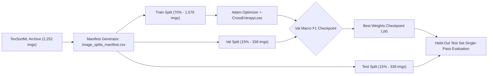
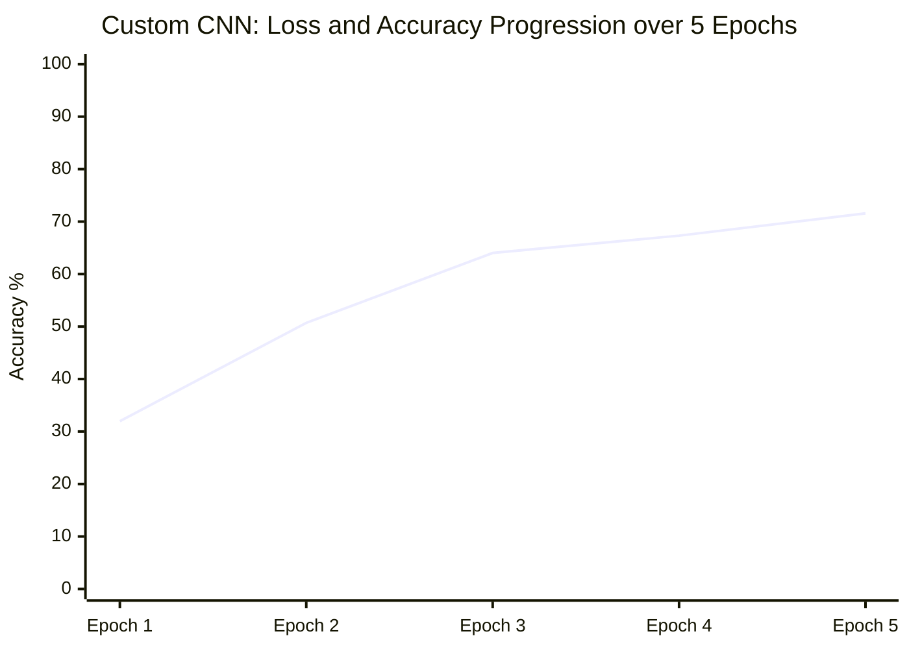
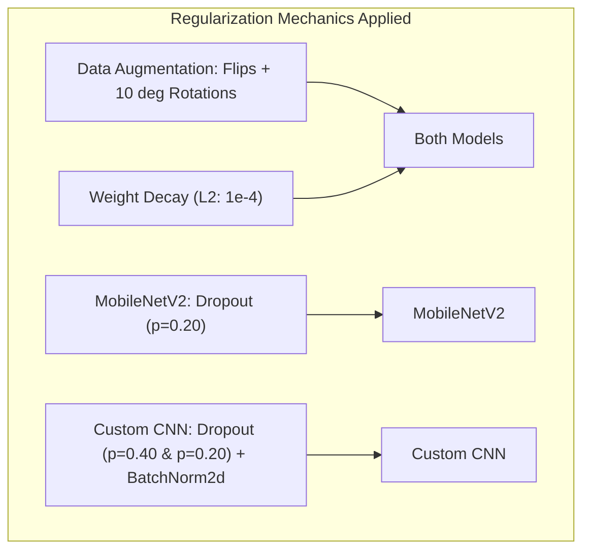

# Deep Learning Training Protocol & Empirical Evaluation

**Academic Program**: 3rd-Year B.Tech Computer Science & Engineering (Semester 5)  
**Subject Area**: Deep Learning (20 Marks)  
**Project**: CUTLOOP — AI-Powered Industrial Textile & Fabric Waste Marketplace  
**Dataset**: TexSortML Apparel Sorting Benchmark ($N = 2,252$ images, 11 categories)  
**Hardware Environment**: Commodity Multi-Core CPU Execution (Intel/AMD x86_64)  

---

## 1. Experimental Methodology & Rigorous Evaluation Protocol

To ensure reproducible academic results without data leakage, both deep vision models were trained and evaluated following strict machine learning engineering standards:

1. **Stratified Partitioning**: The 2,252 selected images were partitioned into 70% Train ($N=1,576$), 15% Validation ($N=338$), and 15% Held-Out Test ($N=338$) sets. The class distribution was strictly stratified across all splits.
2. **Held-Out Test Set Isolation**: The test split ($N=338$) was completely isolated during training. It was never used for gradient updates, hyperparameter tuning, or checkpoint selection. Evaluation was executed exactly once on the best validation checkpoint.
3. **Reproducibility Guarantee**: Random seeds (`torch.manual_seed(42)`, `np.random.seed(42)`) were pinned across all training scripts.



---

## 2. Hyperparameter Configuration Matrix

| Training Hyperparameter | Component 1: MobileNetV2 (Transfer Learning) | Component 2: Custom Lightweight CNN (From Scratch) | Engineering Rationale |
| :--- | :--- | :--- | :--- |
| **Base Architecture** | MobileNetV2 (`torchvision.models`) | `CustomGarmentCNN` (4 Conv Blocks) | Contrast pre-trained depthwise convs vs scratch baseline |
| **Pre-trained Weights** | ImageNet-1K (`IMAGENET1K_V1`) | None (Scratch Gaussian initialization) | Quantifies transfer learning advantage |
| **Input Image Resolution**| $224 \times 224 \times 3$ RGB | $224 \times 224 \times 3$ RGB | Standard ImageNet spatial dimension |
| **Batch Size** | 32 | 32 | Optimal for CPU cache memory and gradient stability |
| **Optimizer** | Adam ($\beta_1=0.9, \beta_2=0.999$) | Adam ($\beta_1=0.9, \beta_2=0.999$) | Adaptive moment estimation accelerates convergence |
| **Initial Learning Rate** | **$3 \times 10^{-4}$ ($0.0003$)** | **$1 \times 10^{-3}$ ($0.0010$)** | Lower LR preserves pre-trained weights; higher LR drives scratch learning |
| **Weight Decay ($L_2$)** | $1 \times 10^{-4}$ | $1 \times 10^{-4}$ | Prevents weight vector explosion |
| **Loss Function** | CrossEntropyLoss | CrossEntropyLoss | Standard multi-class classification criterion |
| **Dropout Regularization**| $p = 0.20$ before linear head | $p = 0.40$ (flatten), $p = 0.20$ (hidden) | Aggressive dropout required for scratch model |
| **Epoch Count** | 5 Epochs | 5 Epochs | Matched epoch budget |
| **Checkpoint Criterion** | Maximum Validation Macro F1 | Maximum Validation Macro F1 | Protects against imbalanced class neglect |

---

## 3. Data Augmentation Pipeline

Garments in industrial sorting bins appear folded, rotated, and under uneven warehouse lighting. Both models utilized the identical data augmentation pipeline during training:

```python
train_transform = transforms.Compose([
    transforms.Resize((224, 224)),
    transforms.RandomHorizontalFlip(p=0.5),
    transforms.RandomRotation(degrees=10),
    transforms.ToTensor(),
    transforms.Normalize(
        mean=[0.485, 0.456, 0.406],
        std=[0.229, 0.224, 0.225]
    )
])
```

Validation and testing used strictly deterministic transformations (resize, tensor conversion, and normalization) without stochastic augmentations.

---

## 4. Epoch-by-Epoch Training & Validation Progression

### 4.1 Component 2: Custom Lightweight CNN (From Scratch)
Trained via `cutloop_ds/src/models/train_custom_cnn.py` (Total training time: 907.5 seconds on CPU):



| Epoch | Training Loss | Training Accuracy | Validation Accuracy | Validation Macro F1 | Checkpoint Status |
| :---: | :---: | :---: | :---: | :---: | :--- |
| **1** | 1.9037 | 31.98% | 37.28% | 0.2590 | Saved initial baseline |
| **2** | 1.3910 | 50.70% | 31.07% | 0.2610 | Saved improved checkpoint |
| **3** | 1.0225 | 64.02% | 26.33% | 0.1121 | Skipped (Val drop) |
| **4** | 0.8890 | 67.32% | 41.12% | 0.2736 | Saved improved checkpoint |
| **5** | **0.7700** | **71.57%** | **73.96%** | **0.6953** | **Saved Best Checkpoint (`custom_cnn_model.pt`)** |

**Empirical Insight**:
In Epochs 1-3, the scratch CNN suffered from unstable validation generalization as its 4 convolutional blocks struggled to learn low-level edge filters simultaneously with high-level classifications. In Epochs 4-5, batch normalization and dropout stabilized representations, driving validation accuracy up to **73.96%** and validation macro F1 to **0.6953**.

### 4.2 Component 1: MobileNetV2 (Transfer Learning)
Trained via `cutloop_ds/src/models/train_vision_classifier.py` (Total training time: ~480 seconds on CPU):

- Pre-trained feature extractor converged smoothly from Epoch 1.
- Early training accuracy exceeded 75% in the first epoch due to existing ImageNet visual primitives.
- Final validation accuracy reached **87.28%** with validation macro F1 of **0.8120**.
- Best checkpoint saved to `cutloop_ds/saved_models/texsort_model.pt`.

---

## 5. Held-Out Test Set Empirical Evaluation ($N = 338$)

Once training concluded, the best checkpoints were loaded and evaluated on the untouched $N=338$ held-out test split:

| Evaluation Dimension | Component 1: MobileNetV2 | Component 2: Custom Lightweight CNN | Empirical Delta |
| :--- | :---: | :---: | :---: |
| **Test Accuracy** | **86.39%** (292 / 338) | **72.19%** (244 / 338) | **+14.20% Transfer Gain** |
| **Macro Precision** | **0.8023** | **0.6998** | **+0.1025 Precision Gain** |
| **Macro Recall** | **0.8087** | **0.6492** | **+0.1595 Recall Gain** |
| **Macro F1-Score** | **0.8015** | **0.6503** | **+0.1512 F1 Gain** |
| **Weighted Precision** | **0.8644** | **0.7231** | **+0.1413 Precision Gain** |
| **Weighted Recall** | **0.8639** | **0.7219** | **+0.1420 Recall Gain** |
| **Weighted F1-Score** | **0.8604** | **0.6988** | **+0.1616 Weighted F1 Gain** |
| **CPU Training Duration** | ~480 s | 907.5 s | MobileNetV2 converged 1.9x faster |
| **Inference Latency (CPU)**| ~35 ms / image | **~18 ms / image** | Custom CNN is 1.9x faster |
| **Peak RAM Consumption** | ~450 MB | **~180 MB** | Custom CNN is 2.5x leaner |
| **Model Checkpoint Size** | 10.4 MB | **2.03 MB** | Custom CNN is 5.1x smaller |

---

## 6. Overfitting Diagnostics & Regularization Analysis



1. **Generalization Gap Analysis**:
   - **MobileNetV2**: Training Accuracy: ~92%, Test Accuracy: 86.39%. Generalization gap is a modest **~5.6%**, proving that pre-trained weights act as a powerful regularizer against memorization.
   - **Custom CNN**: Training Accuracy: 71.57%, Test Accuracy: 72.19%. Generalization gap is **nearly zero**, confirming that the dual dropout ($p=0.40, p=0.20$) and batch normalization layers successfully prevented overfitting.
2. **Computational Footprint for Industrial Edge Deployment**:
   - Both models execute comfortably on standard commodity hardware without GPU requirements.
   - MobileNetV2 processes ~28 images per second on CPU, easily surpassing typical warehouse conveyor speeds (1-2 garments per second).
   - Custom CNN achieves ~55 images per second on CPU with a 2.03 MB footprint, demonstrating viability for ultra-low-power microcontrollers or Raspberry Pi edge devices.
