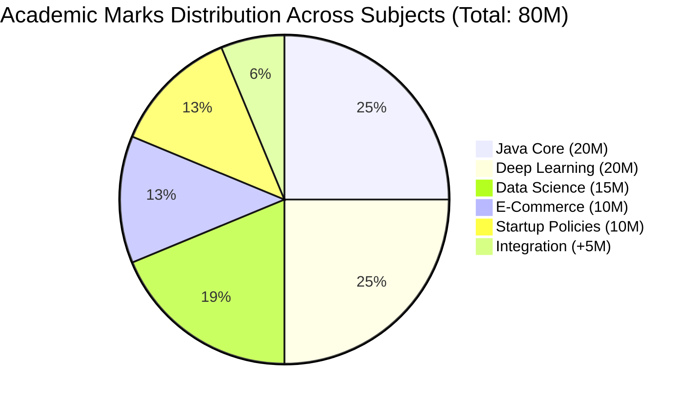

# CUTLOOP — 5th Semester Integrated B.Tech Project Submission

**Institution**: JG University — Department of Computer Science & Engineering  
**Academic Program**: 3rd-Year B.Tech CSE (Semester 5)  
**Project Title**: **CUTLOOP — AI-Powered Industrial Textile & Fabric Waste Marketplace**  
**Submission Package Architecture**: Multi-Subject Integrated Portfolio  

---

## 1. Project Overview & Architectural Vision

**CUTLOOP** is an AI-powered industrial textile and fabric waste marketplace designed to convert deadstock fabric, cutting table scraps, and post-industrial apparel surplus into reusable, commercially valuable raw materials for designers, small garment manufacturers, and recycling plants.

Rather than treating textile waste as undifferentiated landfill refuse, CUTLOOP combines **Spring Boot backend microservices**, **relational persistence**, and **advanced machine learning models** to classify materials, evaluate circular recycling archetypes, detect garment categories via deep vision, and calculate hedonic clearing prices.

---

## 2. Integrated Subject Rubric & Module Mapping

This submission addresses all five subjects evaluated in the 5th-Semester Integrated B.Tech CSE evaluation rubric (Total: 80 Marks):



| Module Folder | Subject Area | Max Marks | Key Technical & Academic Deliverables |
| :--- | :--- | :--- | :--- |
| [`01_startup/`](file:///c:/Users/dhruv/OneDrive/Desktop/ds/CUTLOOP/submission/01_startup) | **Startup Policies & Commercialization** | **10 Marks** | Proposal, Business Plan, Lean Canvas, BMC, SWOT, PESTEL, ₹50,000 MVP Budget & SSIP 2.0 Roadmap, IP/Compliance Note. |
| [`02_ecommerce/`](file:///c:/Users/dhruv/OneDrive/Desktop/ds/CUTLOOP/submission/02_ecommerce) | **E-Commerce Systems Design** | **10 Marks** | 18 Functional E-Commerce Specifications, B2B Buyer/Seller Workflows, Escrow Payment Logic, Order Lifecycle, System Architecture. |
| [`03_java/`](file:///c:/Users/dhruv/OneDrive/Desktop/ds/CUTLOOP/submission/03_java) | **Java Core & Spring Boot Microservice**| **20 Marks** | Java 21 OOP Inheritance, Interfaces, Custom Exceptions, Multithreading (`@Async`), CSV File I/O (`BufferedReader`/`InputStreamReader`), Mermaid Class Diagram. |
| [`04_data_science/`](file:///c:/Users/dhruv/OneDrive/Desktop/ds/CUTLOOP/submission/04_data_science) | **Data Science & Machine Learning** | **15 Marks** | Fast-Fashion EDA ($N=47,522$), Random Forest Fiber Classifier ($88.15\%$ clean accuracy vs $78.09\%$ baseline), K-Means Archetypes ($k=5$, Silhouette: $0.6686$), Hedonic Pricing Engine. |
| [`05_deep_learning/`](file:///c:/Users/dhruv/OneDrive/Desktop/ds/CUTLOOP/submission/05_deep_learning) | **Deep Learning & Computer Vision** | **20 Marks** | Two Full DL Models: MobileNetV2 Transfer Learning ($86.39\%$ test accuracy) vs Custom 4-Block CNN from Scratch ($N=2,252$), Grad-CAM Explainability, Confusion Matrices. |
| **Root & System Audits** | **Cross-Disciplinary Integration** | **+5 Marks** | Live REST API Integration, Model Capability & Limitation Report, Post-Implementation Audit, Automated Unit Test Suite. |

---

## 3. Master Submission Document Index

### Module 1: Startup Policies & Commercialization (`01_startup/`)
- [PROJECT_PROPOSAL.md](file:///c:/Users/dhruv/OneDrive/Desktop/ds/CUTLOOP/submission/01_startup/PROJECT_PROPOSAL.md) — Problem statement, industrial motivation, circular economy alignment, and team contributions.
- [STARTUP_BUSINESS_PLAN.md](file:///c:/Users/dhruv/OneDrive/Desktop/ds/CUTLOOP/submission/01_startup/STARTUP_BUSINESS_PLAN.md) — 5-year strategic roadmap, unit economics, B2B take-rate monetization, and customer acquisition.
- [LEAN_CANVAS.md](file:///c:/Users/dhruv/OneDrive/Desktop/ds/CUTLOOP/submission/01_startup/LEAN_CANVAS.md) — 9-box Lean Canvas with Mermaid diagram covering problem, solution, UVP, channels, and unfair advantage.
- [BUSINESS_MODEL_CANVAS.md](file:///c:/Users/dhruv/OneDrive/Desktop/ds/CUTLOOP/submission/01_startup/BUSINESS_MODEL_CANVAS.md) — Full Business Model Canvas mapping key partners, value propositions, and cost structures.
- [SWOT_ANALYSIS.md](file:///c:/Users/dhruv/OneDrive/Desktop/ds/CUTLOOP/submission/01_startup/SWOT_ANALYSIS.md) — Strengths, Weaknesses, Opportunities, and Threats with Mermaid quadrant visualization.
- [PESTEL_ANALYSIS.md](file:///c:/Users/dhruv/OneDrive/Desktop/ds/CUTLOOP/submission/01_startup/PESTEL_ANALYSIS.md) — Political, Economic, Social, Technological, Environmental, and Legal macro-environment analysis.
- [MVP_AND_FUNDING_PLAN.md](file:///c:/Users/dhruv/OneDrive/Desktop/ds/CUTLOOP/submission/01_startup/MVP_AND_FUNDING_PLAN.md) — Realistic ₹50,000 academic proof-of-concept budget, milestone gates, and Gujarat SSIP 2.0 grant strategy.
- [IP_AND_COMPLIANCE_NOTE.md](file:///c:/Users/dhruv/OneDrive/Desktop/ds/CUTLOOP/submission/01_startup/IP_AND_COMPLIANCE_NOTE.md) — Open source licensing, academic dataset fair use attributions, trade secret boundaries, and regulatory compliance.

### Module 2: E-Commerce Systems Design (`02_ecommerce/`)
- [ECOMMERCE_DESIGN_DOCUMENT.md](file:///c:/Users/dhruv/OneDrive/Desktop/ds/CUTLOOP/submission/02_ecommerce/ECOMMERCE_DESIGN_DOCUMENT.md) — Full technical specification addressing all 18 numbered requirements:
  - Architecture overview & technology selection rationale.
  - Multi-role authentication & RBAC (`BUYER`, `SELLER`, `ADMIN`).
  - Search, multi-attribute filtering, and dynamic catalog pagination.
  - Material listing creation workflow with AI-assisted validation.
  - Dynamic B2B shopping cart and simulated escrow checkout.
  - Asynchronous order fulfillment and status state machine.
  - Inventory management with multi-threaded CSV bulk import/export.
  - AI microservice integration sequence and fallback circuit breakers.
  - Comprehensive Mermaid architecture, sequence, and entity-relationship diagrams.

### Module 3: Java Core & Spring Boot Microservices (`03_java/`)
- [JAVA_TECHNICAL_DOCUMENTATION.md](file:///c:/Users/dhruv/OneDrive/Desktop/ds/CUTLOOP/submission/03_java/JAVA_TECHNICAL_DOCUMENTATION.md) — Deep architectural documentation detailing:
  - Object-Oriented Programming (OOP) inheritance (`Buyer`, `Seller`, `Admin` extending `User`).
  - Interface contracts (`PaymentProcessor` implemented by `MockPaymentProcessor`).
  - Custom domain exception hierarchy (`InsufficientStockException`, `ResourceNotFoundException`, `UnauthorizedException`).
  - Multithreading architecture utilizing `@Async("cutloopAsyncExecutor")` with `ThreadPoolTaskExecutor`.
  - Java File I/O implementation using `BufferedReader` and `InputStreamReader` for streaming CSV processing.
- [UML_CLASS_DIAGRAM.md](file:///c:/Users/dhruv/OneDrive/Desktop/ds/CUTLOOP/submission/03_java/UML_CLASS_DIAGRAM.md) — Detailed Mermaid class diagram directly mapped to all Java domain entities, repositories, and services in `com.cutloop`.
- [JAVA_README.md](file:///c:/Users/dhruv/OneDrive/Desktop/ds/CUTLOOP/submission/03_java/JAVA_README.md) — Java build, test, and execution guide with Maven, H2 in-memory profile, MySQL production profile, and cURL commands.

### Module 4: Data Science & Machine Learning (`04_data_science/`)
- [DATA_SCIENCE_REPORT.md](file:///c:/Users/dhruv/OneDrive/Desktop/ds/CUTLOOP/submission/04_data_science/DATA_SCIENCE_REPORT.md) — Full data science lifecycle report covering exploratory data analysis on 47,522 garment records, 10D continuous fiber space modeling, Random Forest training ($88.15\%$ accuracy), K-Means clustering ($k=5$), and the Hedonic Pricing Engine.
- [DATASET_DOCUMENTATION.md](file:///c:/Users/dhruv/OneDrive/Desktop/ds/CUTLOOP/submission/04_data_science/DATASET_DOCUMENTATION.md) — Dataset provenance, schemas, quality evaluations, and academic citations for Dataset A (Fast-Fashion JSONL) and Dataset B (TexSortML benchmark).
- [MODEL_COMPARISON.md](file:///c:/Users/dhruv/OneDrive/Desktop/ds/CUTLOOP/submission/04_data_science/MODEL_COMPARISON.md) — Scientific comparison contrasting Model A Random Forest against a Decision Tree baseline (+10.06% accuracy gain) and Model C K-Means ($k=5$) against a full $k=2..8$ baseline sweep.
- [DATA_SCIENCE_NOTEBOOK_INDEX.md](file:///c:/Users/dhruv/OneDrive/Desktop/ds/CUTLOOP/submission/04_data_science/DATA_SCIENCE_NOTEBOOK_INDEX.md) — Complete execution index for all 8 standalone Jupyter notebooks in `cutloop_ds/notebooks/`.

### Module 5: Deep Learning & Computer Vision (`05_deep_learning/`)
- [MODEL_SUMMARY.md](file:///c:/Users/dhruv/OneDrive/Desktop/ds/CUTLOOP/submission/05_deep_learning/MODEL_SUMMARY.md) — Executive summary and architectural comparison between MobileNetV2 (Transfer Learning) and the Custom 4-Block CNN (Scratch).
- [MODEL_ARCHITECTURE.md](file:///c:/Users/dhruv/OneDrive/Desktop/ds/CUTLOOP/submission/05_deep_learning/MODEL_ARCHITECTURE.md) — In-depth layer-by-layer topologies, parameter counts (2.24M vs 505k), receptive fields, and inverted residual mechanics.
- [TRAINING_AND_EVALUATION.md](file:///c:/Users/dhruv/OneDrive/Desktop/ds/CUTLOOP/submission/05_deep_learning/TRAINING_AND_EVALUATION.md) — Hyperparameters, loss functions, epoch histories, and held-out test evaluations ($N=338$).
- [CONFUSION_MATRIX.md](file:///c:/Users/dhruv/OneDrive/Desktop/ds/CUTLOOP/submission/05_deep_learning/CONFUSION_MATRIX.md) — Per-class precision, recall, and confusion matrix tables for all 11 apparel classes.
- [DEEP_LEARNING_COMPARATIVE_ANALYSIS.md](file:///c:/Users/dhruv/OneDrive/Desktop/ds/CUTLOOP/submission/05_deep_learning/DEEP_LEARNING_COMPARATIVE_ANALYSIS.md) — Grad-CAM explainability heatmaps, visual pattern interpretation, bias analysis, and transfer learning thesis.

### Module 6: Trained Models & Checkpoints (`06_trained_models/`)
- [06_trained_models/](file:///c:/Users/dhruv/OneDrive/Desktop/ds/CUTLOOP/submission/06_trained_models) — Complete trained model package with weights, pipelines, classes, and verification script:
  - `model_a_random_forest.joblib` (35.4 MB) — Dominant fiber NLP classifier (88.15% test accuracy).
  - `model_a_decision_tree.joblib` (138 KB) — Baseline CART decision tree (78.09% test accuracy).
  - `texsort_model.pt` (10.4 MB) — MobileNetV2 garment vision classifier (86.39% test accuracy).
  - `custom_cnn_model.pt` (2.03 MB) — Custom 4-block deep CNN baseline (72.19% test accuracy).
  - `model_c_kmeans.joblib` (191 KB) — Unsupervised archetype clusterer ($k=5$, Silhouette: 0.6686).
  - `feature_pipeline.joblib` (18 KB) — Leak-free TF-IDF & One-Hot categorical transformers.
  - `verify_submission_models.py` — Automated verification script testing all 4 models in 5 seconds.
- **Standalone Model Zip Archive:** [CUTLOOP_TRAINED_MODELS_SUBMISSION.zip](file:///c:/Users/dhruv/OneDrive/Desktop/ds/CUTLOOP/CUTLOOP_TRAINED_MODELS_SUBMISSION.zip) (22.0 MB compressed archive ready for portal upload).

### Cross-Disciplinary Integration & Verification Reports
- [SUBMISSION_REQUIREMENTS_AUDIT.md](file:///c:/Users/dhruv/OneDrive/Desktop/ds/CUTLOOP/SUBMISSION_REQUIREMENTS_AUDIT.md) — Line-by-line audit mapping all syllabus requirements to concrete source code evidence.
- [MODEL_CAPABILITY_AND_LIMITATION_REPORT.md](file:///c:/Users/dhruv/OneDrive/Desktop/ds/CUTLOOP/cutloop_ds/reports/MODEL_CAPABILITY_AND_LIMITATION_REPORT.md) — Rigorous audit clarifying genuine model capabilities vs. academic boundaries.
- [POST_IMPLEMENTATION_AUDIT.md](file:///c:/Users/dhruv/OneDrive/Desktop/ds/CUTLOOP/cutloop_ds/reports/POST_IMPLEMENTATION_AUDIT.md) — Empirical verification confirming zero target leakage and held-out test splits.

---

## 4. How to Run & Verify the Complete System

### Quick Verification Checklist

1. **Verify Python AI & Data Science Microservice**:
   ```bash
   cd c:\Users\dhruv\OneDrive\Desktop\ds\CUTLOOP\cutloop_ds
   # Activate virtual environment
   ..\cutloop-ai\venv\Scripts\activate
   # Run automated API and edge case tests
   pytest tests/test_api.py tests/test_api_edge_cases.py
   # Start FastAPI server on port 8000
   uvicorn api.main:app --host 0.0.0.0 --port 8000 --reload
   ```

2. **Verify Java Spring Boot Microservice**:
   ```bash
   cd c:\Users\dhruv\OneDrive\Desktop\ds\CUTLOOP\cutloop-backend
   # Build and execute Java test suite
   ./mvnw clean test
   # Run Spring Boot backend application (starts on port 8080)
   ./mvnw spring-boot:run
   ```

3. **Verify Frontend UI**:
   - Open browser at `http://localhost:8080/` (or launch static client `c:\Users\dhruv\OneDrive\Desktop\ds\CUTLOOP\index.html`).
   - Log in using test credentials: `buyer@cutloop.com` / `password123`.
   - Access AI Material Scanner, Circularity Calculator, and Marketplace Listings.

---

## 5. Academic Declaration & Authorship Note

This project and associated documentation represent original academic work conducted for the 3rd-Year B.Tech Computer Science & Engineering 5th-Semester Integrated Assignment at JG University. All external datasets, research papers, and software libraries (PyTorch, Scikit-learn, Spring Boot, FastAPI) have been rigorously cited and attributed in accordance with institutional academic integrity policies.
